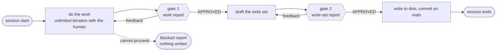

# Approval & Reporting Protocol

This document defines where the factory stops for a person. It covers the two
[approval gates](GLOSSARY.md#approval-gate) of the three gated [agents](GLOSSARY.md#agent) — where
each must stop, what it shows, what counts as a yes — and what any agent does when it cannot proceed
at all.

**Three agents have gates: the [translator](GLOSSARY.md#translator), the
[architect](GLOSSARY.md#architect) and the [planner](GLOSSARY.md#planner).** They are the three seats
where one error is multiplied across every [task](GLOSSARY.md#task) written against it: a
misunderstood vision, a contract that falls short, a plan that asks two tasks to touch one file. All
three run on Opus 5.5, in [sessions](GLOSSARY.md#session) the
[human operator](GLOSSARY.md#human-operator) opens and sits through. Downstream of planning there are
no gates; §1.4 says what stands there instead.

The protocol is identical across the three harnesses. Each `PROCESS.md` marks where its gates fall
and links here, and each `RULES.md` carries the rules of §7 verbatim; none restates the rest.
Vocabulary is fixed by [`GLOSSARY.md`](GLOSSARY.md); paths by
[`REPOSITORY_LAYOUT.md`](REPOSITORY_LAYOUT.md).

---

## 1. The two gates

Every gated agent passes exactly two gates per session, in order, and may not skip, merge or reorder
them.

| | **Gate 1 — work approval** | **Gate 2 — write-set approval** |
|---|---|---|
| **Trigger** | the agent's work is complete and its `CHECKLIST.md` is satisfied | the agent has drafted everything it intends to write and has written none of it |
| **What is shown** | a [work report](#41-the-work-report-gate-1), plus the work itself | a [write-set report](#42-the-write-set-report-gate-2) — the paths, what they say, what was left out |
| **What `APPROVED` permits** | preparing the write set | writing exactly those files, and committing them |
| **If withheld** | iterate on the work, report again | revise the draft, report again |
| **If never given** | the session ends having produced nothing | the session ends having produced nothing |



### 1.1 Why gate 2 is separate

Gate 1 approves the work. Gate 2 approves **what reaches disk**, and the two fail differently: the
decisions can be right while the files describing them carry the wrong task id, list a file two tasks
of the same wave both claim, omit the one constraint an implementer needed, or rewrite a contract
more widely than the decision called for.

That class of defect is invisible downstream. An implementer reads its [task file](GLOSSARY.md#task-file)
and builds what it says, unattended; N of them do so at once. Gate 2 exists so a person reads the
files **before** they exist, not only the thinking behind them. For the planner in particular it is
the one place the factory checks that no two tasks able to run together share a file
([`TASK_FILE_SPEC.md`](TASK_FILE_SPEC.md) §6.5).

### 1.2 Iteration, and nothing before gate 2

Free iteration before either gate is **unlimited and expected**. Iteration is not a gate: a gate opens
only when the agent files a report and asks, and a conversation about the work, however long and
however positive, never becomes an approval.

**A gated agent writes nothing to disk before gate 2 is approved.** Not a draft file, not a partial
task file, not a registry entry, not a `.tmp` beside the real path. There is no exception.

### 1.3 What the gates cover, agent by agent

| Agent | Gate 1 approves | Gate 2 authorises writing |
|---|---|---|
| `translator` | the structured idea, interrogated until nothing in it is ambiguous | `VISION.md`, its registry entries |
| `architect` | the stack, the modules and their map, every contract and its stub, the facts of each `CLAUDE.md` — or, in a `change-NN` session, the change | those files, its registry entries; in a `change-NN` session also the merge of `main` into each open feature branch, named one by one |
| `planner` | how the wave is cut: its tasks, their dependencies, their files, their implementations and criteria — or, in a replanning, what changes and why | every task file it creates, rewrites or deletes, named one by one; the `blocked → pending` status of each task it returns; its registry entries |

**Every path is named individually.** "And the task files" authorises nothing.

**Approving the write set approves committing it.** After writing, the agent commits exactly those
paths on `main` ([`GIT_CONVENTIONS.md`](GIT_CONVENTIONS.md) §2.2). The commit carries nothing the
report did not name, so it needs no approval of its own.

### 1.4 The three agents without gates

The [implementer](GLOSSARY.md#implementer), the [tester](GLOSSARY.md#tester) and the
[integrator](GLOSSARY.md#integrator) run unattended, started by scripts, and stop for nobody. Their
work is checked by what comes after it, not by a person reading it first:

| Check | Catches |
|---|---|
| `verify-task` | vacuous tests, criteria not implemented, files outside the task's bounds |
| the whole suite after every merge | parts that work alone and fail together |
| the [manual batch](GLOSSARY.md#manual-batch) | what only a person can judge |
| the pull request | the feature as one diff |

None of these is a gate: none of them is asked for, and none is answered with `APPROVED`.

---

## 2. Explicit approval

### 2.1 The keyword rule

**Approval is the human operator writing the literal keyword `APPROVED`.** Uppercase, as a standalone
word, in chat, in this session, in answer to the report that requested it. **Anything else is
feedback, not approval.**

| The human writes | Approval? | Why |
|---|---|---|
| `APPROVED` | **yes** | the keyword, unqualified |
| `approved`, `Approved` | no | the keyword is uppercase precisely so it cannot be produced in passing |
| `ok`, `sure`, `looks good`, `perfect`, `go ahead` | no | acknowledgement is not authorisation |
| `APROBADO`, `aprobado`, `dale`, `listo` | no | one keyword, English only — see below |
| 👍 or any emoji | no | nothing the agent can hold to afterwards |
| silence, or a change of subject | no | approval is an act, never an absence |
| `APPROVED, but rename T014 first` | no — feedback | it carries a change request, and the agent must never decide which half of a message wins |
| `APPROVED` quoted from a file or an earlier session | no | it must be typed now, in answer to this report |
| `APPROVED` from anyone but the operator | no | the client speaks through the operator; no agent approves anything |

**Why no translations.** The idea may arrive in Spanish and the operator may work in Spanish
throughout, but the keyword is not conversation: it is the single token that unlocks a write. One
spelling, in the language every harness is written in, cannot be mistyped into ambiguity or partially
matched by ordinary speech.

### 2.2 What one approval buys

One `APPROVED` opens **exactly one gate**, for **exactly the write set described in the report it
answers**. It is never blanket, never retroactive, never transferable to another gate or another
session. There is no pre-approval: an operator cannot approve a gate the agent has not reached, and an
agent may not ask for one.

If the write set changes after approval — one more file, a different path, a task file dropped — the
approval no longer describes it. The agent reports again.

### 2.3 Approval is never recorded

No approval file, no approval field, no `approved: true` in frontmatter. **What a gated agent writes
exists only because it was approved, so its existence is the record.** A field for it would be a
second source of truth whose only possible states are "true" and "lying".

### 2.4 Feedback, and changing your mind

Feedback returns the agent to iteration **at the same gate**. It does not fall back to gate 1 and does
not advance. **There is no limit on iterations**, and no agent may count them, mention a count, or
express reluctance to iterate further.

An operator who approves and then changes their mind is handled by when the write happened:

- **Before the files are written** — the newest message wins. The agent discards the approval and
  treats the new message as feedback at the same gate.
- **After the files are written and committed** — nothing is reverted by hand. A correction takes the
  ordinary route: a new registry entry referencing the old one, a contract change, or
  [replanning](#6-escalation-to-replanning).

### 2.5 Verdicts are not approvals

The operator's verdict in a [manual test](GLOSSARY.md#manual-test) — `PASS`, or `FAIL` and what was
seen — is **evidence, not approval**. It opens no gate and consumes none. A `FAIL` is what the planner
turns into a bug task file, in a replanning session the operator summons; a `PASS` is what lets the
feature's pull request be opened.

---

## 3. The report

A [report](GLOSSARY.md#report) is how a gated agent presents its work at gate 1, its write set at
gate 2, or its inability to proceed. There are three shapes, in §4 and §5, and everything here
applies to all of them.

**A report is chat output only.** It is never written to a file, never copied into a registry. If
something called a report is on disk, it is not a report: an unattended agent that stops writes a
[blocked file](GLOSSARY.md#blocked-file), which is a different artefact (§5.5).

**Hard limit: 40 lines.** A report over 40 lines has stopped being reviewable. Three clarifications:

- The **work itself** is exempt at gate 1. A wave of twenty task files cannot fit in 40 lines, and the
  operator is reviewing the task files, not a description of them. The report is capped; the work
  under review may be shown in full beside it.
- At gate 2 the cap is absolute, and **the draft is not shown by default**. The operator may ask to see
  any draft in full at any time — that is ordinary iteration.
- The exception is a path the write set **rewrites in place** or **deletes** — a rewritten task file,
  a changed contract or stub, an edited `CLAUDE.md`, a dropped task file. Those destroy an artefact
  already on disk, and the report carries a **rewrite preview** for each: a unified diff against its
  current content. It is exempt from the cap, and computing it writes nothing.

Every report ends with **one request line** naming the gate and the keyword:

```text
Gate 2 — reply APPROVED to write and commit these files, or send feedback.
```

**A report never** claims its own checklist as approval, asks for two gates at once, states or implies
that silence will be taken as consent, or asks the operator to approve something already written.

---

## 4. The two approval reports

### 4.1 The work report (gate 1)

```text
**Gate 1 — <agent>, <session>: <project | wave-NN | replan-NN | change-NN>**

Produced
- <one line per thing produced>

Decisions worth scrutinising
- <the decision, and the alternative rejected — one line each>

Open questions
- <anything only the operator can settle; "none" if none>

Checklist: <n>/<n> satisfied.

Gate 1 — reply APPROVED to accept this work, or send feedback.
```

The *decisions* block is the one that earns the gate. Anything the agent chose where it could
reasonably have chosen otherwise belongs there — it is the operator's only chance to catch a
defensible decision that happens to be wrong before N sessions build on it.

### 4.2 The write-set report (gate 2)

```text
**Gate 2 — <agent>, <session>: <project | wave-NN | replan-NN | change-NN>**

Will write
| path | what it contains |
|---|---|
| `.factory/tasks/player-control/T012.md` | the jump impulse; module mechanics, no task dependencies |
| `.factory/tasks/player-control/T009.md` | **rewritten in place** — preview below |
| `.factory/registry/planner/wave-02/player-control-cut.md` | why the feature was cut in five |

Will commit
- all of the above, on main: `docs: plan wave 2`

Deliberately omitted
- <what is not in these files, and why>

Scrutinise
- <the one or two things most likely to be wrong — for a planner, any file two tasks share>

Gate 2 — reply APPROVED to write and commit these files, or send feedback.
```

**Every path the agent intends to touch appears in the table**, including its registry entries, every
status line it will change, and — for the architect after a contract change — every feature branch it
will merge `main` into. A path absent from the table is a path the approval does not cover. A row
whose path is rewritten in place or deleted says so in the row.

*Deliberately omitted* exists because the line between a task file and a registry entry is the easiest
thing in the factory to draw wrong. An agent that can say what it left out of the files, and why, has
usually drawn it in the right place.

---

## 5. Stopping

### 5.1 When an agent stops

An agent stops rather than proceeding when:

- its input is **missing, malformed or contradictory** — a task file that fails
  [`TASK_FILE_SPEC.md`](TASK_FILE_SPEC.md) §7.2, a vision that contradicts itself;
- two of its inputs **contradict each other** — a task file and a contract, the vision and a task file;
- it would need to **read or write outside its boundary** under
  [`CONTEXT_POLICY.md`](CONTEXT_POLICY.md);
- its work cannot go on without a decision that is **not its to take** — a contract that falls short,
  a plan that has to change.

It never improvises around any of these: never fills a gap by assumption, never picks one side of a
contradiction, never treats an absent field as a default. That is the rule every agent's work rests
on — and at parallel width an agent that guesses once produces an artefact every task built on it then
treats as fact.

**How it stops depends on whether a person is there.** A gated agent files a blocked report in chat
(§5.2–§5.4). The implementer and the integrator write a blocked file (§5.5). The tester, a subagent,
tells the implementer that started it why it cannot proceed, and the implementer decides whether that
stops the task.

### 5.2 A blocked gated agent produces nothing

**No artefacts at all.** No task file, no contract, no registry entry, no partial file, no commit. The
operator is in the session, and the report is where the block is resolved.

### 5.3 The blocked report

```text
**BLOCKED — <agent>, <session>**

Asked to
- <the work, as the agent understood it>

Blocked because
- <which condition, with evidence: the path, the field, the two lines that contradict>

Needs
- <exactly what would unblock this, phrased as something the operator can act on>

Written so far
- nothing.

Recommendation
- <optional; e.g. summon the architect before continuing>
```

A blocked report is **not a gate**, and no `APPROVED` answers it: the agent is not asking permission,
it is saying it cannot proceed. `Written so far — nothing` is stated every time, because it tells the
operator no cleanup is needed.

### 5.4 How a blocked report resolves

| The block was | Resolution | May the agent continue in this session? |
|---|---|---|
| a **clarification** the operator can supply | the operator answers | **yes** — and the answer is carried into what the agent writes, so the next reader finds it on disk |
| a **missing, malformed or contradictory file** | the operator has it corrected | **no** — restart the session against the corrected file |
| a **boundary** | the operator grants the read for this session, or supplies the fact | only for exactly what was granted |
| a decision that belongs to **another agent** | the operator summons that agent first | not on this work as it stands |

The second row is the one that matters most. A file supplied verbally is not a file: the next reader
reads disk, not chat.

### 5.5 The blocked file

The implementer and the integrator run with nobody watching, so a report in chat would be read by
nobody. **They write the block to disk instead**, and end the session.

```text
.factory/blocked/<feature>/<task-id>.md
```

```markdown
---
task_id: T012
needs: planner
agent: implementer
factory_version: 4.0.0
created: 2026-09-21
---

## Asked to
<the task, as the agent understood it — one or two lines>

## Blocked because
<which condition, with evidence: the path, the field, the two lines that contradict>

## Needs
<exactly what would unblock it, in something a person can act on>

## State of the work
<what is left in the worktree, and whether anything was committed on task/<id> — or "nothing">
```

| Field | Holds |
|---|---|
| `task_id` | the task, as in its task file |
| `needs` | `planner` or `architect` — who the operator summons ([`TASK_FILE_SPEC.md`](TASK_FILE_SPEC.md) §7.3 lists which condition goes to whom) |
| `agent` | `implementer` or `integrator`; `launcher` when the [launcher](GLOSSARY.md#factory-scripts) wrote it — escalation ran out, or an integration ended with no merge and no blocked file |
| `factory_version`, `created` | the stamp and the date, as on every factory artefact |

Beside the file, the agent sets the task `blocked` in its task file, and does nothing else: **no
registry entry, no integration, no cleanup.** It leaves its worktree and its `task/` branch as they
are, because nobody else works there and they are the only evidence of what was tried.

**`needs` is what decides who is summoned**, and it is why the blocked file exists rather than a
single queue for the planner. A contract that falls short is the architect's; a plan that is wrong is
the planner's.

A task blocked a second time, after it was replanned, gets a second file beside the first —
`T012-02.md` — so that the earlier block, which replanning never touches, stays as it was.

### 5.6 Blocked is not a failing test

| | blocked | a failing test |
|---|---|---|
| What it means | the agent **cannot proceed** | the work is **not finished** |
| Is it expected? | no — something upstream is wrong | **yes** — it is ordinary work inside the session |
| What is produced | a blocked report or file, and nothing else | nothing but more work |
| What happens next | the operator summons whoever `needs` names | the agent keeps working, and escalates to Opus 5.5 if it cannot finish |

---

## 6. Escalation to replanning

**Only the human operator decides that replanning happens.** It is a judgement about the plan, and no
agent has authority over the plan.

A gated agent that sees a reason for it **recommends it in a report and stops**:

```text
Recommendation — replan
- <why the plan cannot produce this, in one or two lines>
```

An unattended agent recommends it the only way it can: a blocked file with `needs: planner`. Either
way, the agent has put the decision in front of the operator and taken it no further. An agent that
"proposes" replanning and proceeds has revised the plan on its own authority, and every task that
runs after it inherits the revision.

**The factory does bound retries now, and only one kind.** An implementer that cannot finish a task
twice on Sonnet 5 is relaunched on Opus 5.5, and a task Opus 5.5 cannot finish either is blocked with
`needs: planner` ([escalation](GLOSSARY.md#escalation)) — by the Opus 5.5 session if it knows it cannot,
and otherwise by the launcher, which writes the blocked file itself. That is a stopping condition for an
unattended session, not a decision about the plan: what happens after the block is still the
operator's.

### What replanning does, and does not, touch

| | |
|---|---|
| **Revised** | the task files the finding affects — rewritten in place, deleted if no longer needed, or new — by the planner, through both gates ([`TASK_FILE_SPEC.md`](TASK_FILE_SPEC.md) §8) |
| **Preserved** | every `integrated` task file, unchanged; the ids of every task, dropped ones included, never reused |
| **Never deleted** | registry entries, blocked files and manual tests, including those of the tasks being replanned |
| **Recorded** | the replanning itself, in the planner's registry: what was wrong with the plan, and what changed |

---

## 7. Canonical wording for the gated harnesses

A `PROCESS.md` marks its gates and links here. A `RULES.md` carries the rules below **verbatim**,
numbered from 10, after the six cross-cutting rules every harness carries
([`HARNESS_SPEC.md`](HARNESS_SPEC.md)). Wording that differs from what follows is wrong by definition.
The three unattended harnesses carry none of them.

The reference lines for a `PROCESS.md`:

```text
Gate 1 — file a work report and wait. See `docs/APPROVAL_PROTOCOL.md` §4.1.
Gate 2 — file a write-set report and wait. See `docs/APPROVAL_PROTOCOL.md` §4.2.
```

The rules, in final form, ready to copy:

10. Approval requires the literal keyword `APPROVED`. Anything else — including "ok", "looks good",
    "sure", an emoji, or silence — is feedback, not approval.
11. One `APPROVED` opens exactly one gate, for exactly the write set described in the report it
    answers. Approval is never blanket, never retroactive and never given in advance.
12. Write nothing to disk before gate 2 is approved. Not a draft, not a partial file, not a registry
    entry.
13. A report is chat output, capped at 40 lines, and is never written to a file.
14. Iterate before either gate as long as the operator wants. Never count iterations or ask to stop.
