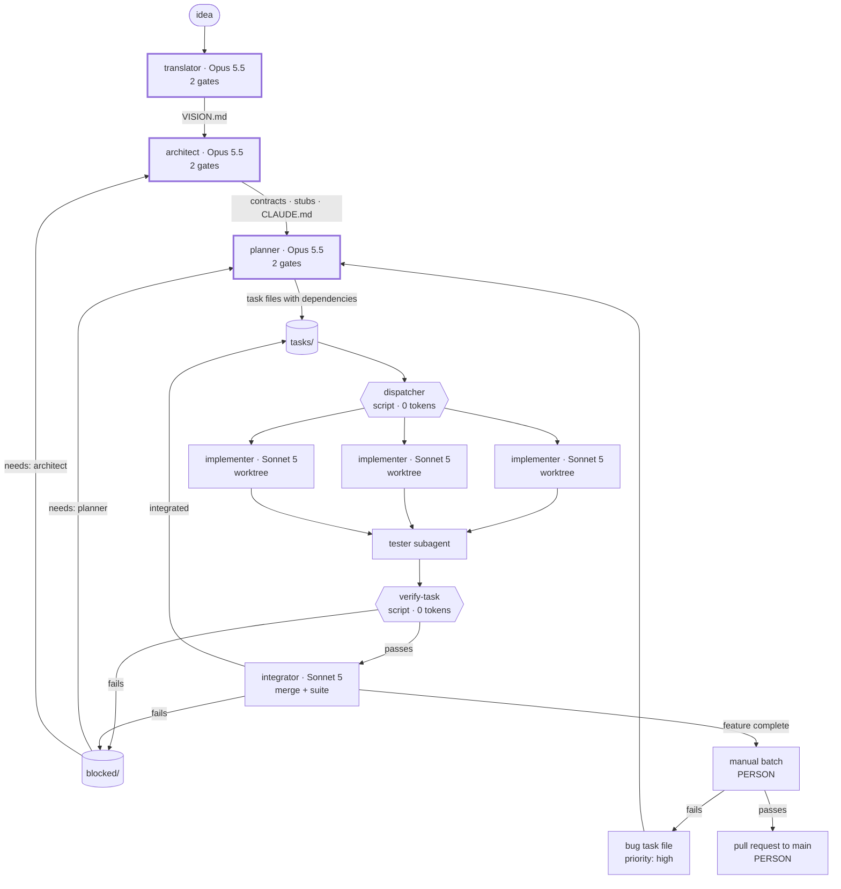

# Pipeline Architecture

This document describes the Conectium Game Factory as a system: the six agents, what flows between
them, where a person stops the work and where nobody does, what happens when something fails, and
the cost reasoning behind every structural choice. It is the document to read first after the README,
and the one to come back to when a rule in a protocol stops making sense on its own.

It describes the system; the protocol documents define it. Where this document and a protocol
disagree, **the protocol wins** and this one has a defect worth reporting. Vocabulary is fixed by
[`GLOSSARY.md`](GLOSSARY.md); paths by [`REPOSITORY_LAYOUT.md`](REPOSITORY_LAYOUT.md).

---

## 1. Why it is shaped this way

Until `4.0.0` the factory was five agents in a line, with a person between every pair of them and
two approvals inside every session. It worked, and it was slow for two independent reasons:

| Delay | Cause | What removes it |
|---|---|---|
| **Waiting at gates** | six human stops per task, spread over three sessions | no gates on implementation, verification or integration |
| **Artificial serialisation** | at most one task alive at a time, even when nothing linked it to the next | a plan of tasks with explicit dependencies, and everything free running at once |

The two multiply. A project stopped taking `T × (t_agent + t_human)` and takes roughly
`D × t_agent + T × t_integration`, where `D` is the **depth** of the dependencies, not the number of
tasks. The second cause was the larger one, and the old design could not see it: it serialised tasks
that had nothing to do with each other, because it assumed an operator doing one thing at a time.

### 1.1 What that costs

The cost of an error stops being paid in waiting and starts being paid in rework — and parallelism
**multiplies** the cost of a wrong contract instead of dividing it: N sessions discover it at once,
each with code already written against it.

Hence the one structural rule of the design that is not negotiable: **the gates survive exactly
where an error is multiplied** — the [translator](GLOSSARY.md#translator), the
[architect](GLOSSARY.md#architect) and the [planner](GLOSSARY.md#planner). Downstream of planning
there are none.

### 1.2 The bottleneck moves

At four to six times the throughput, the limit stops being development and becomes the
[manual batch](GLOSSARY.md#manual-batch) — now the only check a person makes on the implementation,
run once or twice a day. Two consequences follow, and both are rules:

- A [manual test](GLOSSARY.md#manual-test) exists only for what **only a person can judge** — feel,
  look, response. If an automated test can see it, it is not in the batch.
- **Most tasks produce none.** Most have nothing a person could observe.

---

## 2. Principles

1. **Contracts first.** Interfaces, events and shared state are defined before anything is
   implemented, and they are **code**. Tasks depend on [contracts](GLOSSARY.md#contract), which exist
   from the first day — not on implementations.
2. **A working skeleton.** From wave 0 the game compiles with [stubs](GLOSSARY.md#stub), and every
   task replaces a stub with a real implementation.
3. **One file, one writer.** Under parallelism, any artefact two agents could write at once is split
   until every file has a single writer. No exceptions.
4. **Tasks own their files.** Two tasks alive at the same time never touch the same file. The planner
   guarantees it when it writes a wave and the operator checks it at the planner's gate 2; no script
   checks it afterwards. [Shared files](GLOSSARY.md#shared-file) are edited by the integrator alone.
5. **Plan once, in task files.** What an Opus decides is written down. Implementers read their
   [task file](GLOSSARY.md#task-file); they do not re-derive the plan.
6. **Scripts do what is mechanical.** Deciding what runs next, starting sessions, running and checking
   tests spend no tokens and make no mistakes of judgement.
7. **The person decides; the person does not orchestrate.** Human judgement is kept for contracts,
   manual tests and pull requests.
8. **Rigidity only where it buys something.** A rule that forces a replanning over a trifle costs
   more than it protects. The design replaces prohibitions with gradients wherever it can.

---

## 3. The pipeline

### 3.1 Roster

| Agent | Model | Gates | Runs | [Level](GLOSSARY.md#level) |
|---|---|---|---|---|
| [`translator`](GLOSSARY.md#translator) | Opus 5.5 | **2** | once per project | project |
| [`architect`](GLOSSARY.md#architect) | Opus 5.5 | **2** | once per project, plus each contract change | project |
| [`planner`](GLOSSARY.md#planner) | Opus 5.5 | **2** | once per [wave](GLOSSARY.md#wave), plus each [replanning](GLOSSARY.md#replanning) | wave |
| [`implementer`](GLOSSARY.md#implementer) ×N | Sonnet 5, Opus 5.5 on [escalation](GLOSSARY.md#escalation) | none | once per task | task |
| [`tester`](GLOSSARY.md#tester) | **Sonnet 5**, as a subagent of the implementer | none | once per task | task |
| [`integrator`](GLOSSARY.md#integrator) | **Sonnet 5** | none | once per task on merging, once per feature on closing it | task and feature |

**The three gated seats all run on Opus 5.5**, for the same reason they have gates: they are where one
error is multiplied across every task.

**The integrator is never Haiku.** It merged the old integrator and committer, and a seat's model is
set by its hardest job, not its cheapest: it merges, runs the suite, **edits shared files** — which is
writing code — and writes the commit messages and the pull request.

**The tester is a subagent, not a session.** It runs inside the implementer's session, on Sonnet 5,
and inherits its context. The tester's independence is retired on purpose: in `3.x` it cost an Opus
session per task and did not prevent wrong verdicts. What stands in its place is `verify-task`, a
script (§6).

Model assignment is part of the factory contract, not a preference. An agent run on the wrong model is
a defect, not a substitution.

### 3.2 Diagram



The thick borders are the three gated seats. Everything else runs unattended.

### 3.3 Where a person stops the work

| Point | When | Why it is a person's |
|---|---|---|
| **The gates** | gates 1 and 2 of the translator, the architect and the planner | an error there is multiplied by every task running at once |
| **The manual batch** | once or twice a day, per feature | it sees what no test can, and it is where bugs come from |
| **The pull request into `main`** | when a feature is closed | the last look before something is stable |

The gates are fixed by [`APPROVAL_PROTOCOL.md`](APPROVAL_PROTOCOL.md). The other two are not gates:
nothing asks for them and nothing is answered with `APPROVED`.

### 3.4 What the person does between those points

- Run the [launcher](GLOSSARY.md#factory-scripts).
- Summon the planner for the next wave.
- Summon the planner or the architect for a [blocked file](GLOSSARY.md#blocked-file), as its `needs`
  field says.
- Summon the planner to write the bug task files after a manual batch.
- Commit the state of execution on `main`, push, open the pull request and merge it
  ([`GIT_CONVENTIONS.md`](GIT_CONVENTIONS.md) §6).
- Decide to adopt a newer factory version — a game never upgrades itself.

Everything else — choosing the next task, opening worktrees, starting sessions, verifying, merging
into the feature — is done by a script or by an unattended agent.

### 3.5 How a project starts

The order is fixed. Steps 1 to 3 are gated sessions; from step 4 the pipeline runs unattended.

| # | Who | Produces | Compiles? |
|---|---|---|---|
| 1 | translator | `VISION.md` | — |
| 2 | architect | `contracts/`, **the stub of each**, the root and module `CLAUDE.md` files | not yet |
| 3 | planner | **wave 0**, the tooling, and wave 1 | not yet |
| 4 | implementers | wave 0, as the `tooling` feature: manifest, language configuration, linter, test runner, build — merged into `main` before anything else | **yes, from here** |
| 5 | implementers ×N | wave 1, in parallel, feature by feature | yes |

**The architect writes contracts and stubs as text, with no compiler**, and does not need one: a stub
is a mechanical projection of its contract ([`CONTRACT_SPEC.md`](CONTRACT_SPEC.md) §3). Wave 0 is
what makes all of it compile and run green, and from wave 1 on everything is parallel.

---

## 4. Units of work

```text
1 project = 1 game             the translator and the architect run once
1 feature = 1 feat/ branch     = 1 pull request
1 task    = 1 task/ branch     = 1 worktree = 1 commit, merged by the integrator
1 wave    = 1 planner session  — not a git unit
```

**A wave is a unit of planning, not of git.** It is what the planner details in one session, and it
usually **crosses features** — which is where the parallel width comes from. A feature is still one
branch and one pull request, and **several feature branches are open at once**. A feature's pull
request is opened when all *its* tasks are `integrated` and its manual batch has passed, without
waiting for the rest of the wave.

**A task's dependencies stay inside its feature.** `integrated` means merged into the task's own
feature branch, which no other feature sees until it reaches `main`. Wave 0 is therefore its own
feature, `tooling`, and it reaches `main` first ([`GIT_CONVENTIONS.md`](GIT_CONVENTIONS.md) §1.4).

The branches, the worktrees, the two commits a task produces and who makes each are in
[`GIT_CONVENTIONS.md`](GIT_CONVENTIONS.md).

---

## 5. What flows between agents

There is **one handoff left**: the task file, from the planner to the implementer who builds it, read
also by that task's tester and integrator. Every other artefact has one writer, a fixed path and
declared readers, and is addressed to nobody in particular.

| Artefact | Written by | Read by | Specified in |
|---|---|---|---|
| `VISION.md` | translator | everyone | [`GLOSSARY.md`](GLOSSARY.md#vision-visionmd) |
| `contracts/`, the stubs | architect | everyone | [`CONTRACT_SPEC.md`](CONTRACT_SPEC.md) |
| every `CLAUDE.md` | architect | everyone, loaded automatically | [`CONTRACT_SPEC.md`](CONTRACT_SPEC.md) §5 |
| a task file | planner | its implementer, tester and integrator; the architect | [`TASK_FILE_SPEC.md`](TASK_FILE_SPEC.md) |
| a registry entry | every agent, its own | its writer; the integrator reads the implementer's for its task; the planner reads all | [`REGISTRY_SPEC.md`](REGISTRY_SPEC.md) |
| a blocked file | the implementer or the integrator | the operator, the planner, the architect | [`APPROVAL_PROTOCOL.md`](APPROVAL_PROTOCOL.md) §5.5 |
| a manual test | the tester | the operator, the planner | [`GLOSSARY.md`](GLOSSARY.md#manual-test) |
| a merge commit and its message | the integrator | whoever reads the history | [`GIT_CONVENTIONS.md`](GIT_CONVENTIONS.md) §3.2 |
| `pr.md`, the pull request body | the integrator | the operator | [`GIT_CONVENTIONS.md`](GIT_CONVENTIONS.md) §5.3 |

Three things the old pipeline wrote no longer exist. **The translator writes one thing**: the project
handoff that duplicated the vision is gone. **The architect writes no handoff to the planner**: it
leaves contracts, stubs and `CLAUDE.md` files. **The implementer writes no handoff to anyone**: the
integrator reads the implementer's registry entry, which already holds the *why* its commit needs.

Who may read what, write what and run which git command is fixed by
[`CONTEXT_POLICY.md`](CONTEXT_POLICY.md).

---

## 6. How the work is checked

Without gates on implementation, without an independent tester and without strict TDD, quality rests
on five things, in this order:

| # | Mechanism | Catches |
|---|---|---|
| 1 | **The task file** — implementation, interfaces and criteria written by Opus 5.5, under gates | building the wrong thing |
| 2 | **The tester subagent** | what the tests cover and what they miss; it proposes the manual test |
| 3 | **`verify-task`** — mechanical checks | vacuous tests, criteria not implemented, files out of bounds |
| 4 | **The whole suite after every merge** | parts that work alone and fail together |
| 5 | **The manual batch** | what only a person can judge |

**Link 1 carries the most weight**, which is why the planner keeps both its gates. Links 2 and 3 run
in that order: the tester runs after the tests are green and before `verify-task`, so that the manual
test it proposes belongs to the same task the script certifies. What `verify-task` checks, and why
check 4 is what replaced writing the test red first, is in [`TASK_FILE_SPEC.md`](TASK_FILE_SPEC.md)
§5.2.

---

## 7. Failure

Failure has two shapes, and confusing them is the commonest way to mishandle it.

**A block** is an agent that cannot proceed: its input is wrong, a contract falls short, the work
would cross its module, escalation ran out, or an integration failed. It stops and says so — a gated
agent in chat, an unattended one in a blocked file whose `needs` names who is summoned. When
escalation runs out without the session saying so, the launcher writes that file itself. **The rest of
the wave keeps working**: the dispatcher stops offering the blocked task and what depends on it, and
nothing else.

| `needs` | What happens |
|---|---|
| `planner` | the planner replans **only the affected tasks** and returns the task to `pending` |
| `architect` | the architect fixes the contract and its stub under its two gates, and merges `main` into the open feature branches; **then** the planner replans and returns the task to `pending` |

**A bug** is finished work that a person found wrong in the manual batch. It never reopens the task it
came from, which is already merged: the planner writes a **bug task file**, with `priority: high` and
a criterion that reproduces the failure, and the feature's pull request waits until it passes
([`TASK_FILE_SPEC.md`](TASK_FILE_SPEC.md) §8.2).

Three rules govern both:

- **Only the operator decides that replanning happens.** An agent that finds a reason for it says so
  and stops.
- **Only the planner returns a task to `pending`.** The architect fixes contracts and sets the status
  of no task.
- **Nothing is deleted to recover.** A blocked task's branch and worktree are kept until replanning
  decides; blocked files, registry entries and manual tests survive every replanning.

---

## 8. Cost model

One observation shapes the design: in an AI pipeline the expensive failure is not a slow session, it
is a wrong artefact that many sessions build on. At parallel width "many" means "at the same time".

- **Expensive judgement early, cheap execution late.** Three Opus 5.5 sessions with gates decide what the
  game is, how its parts meet and what every task contains, including its code. The work they hand
  down is executed by Sonnet 5, unattended, because a task file that leaves nothing to decide can be
  built by the cheaper model — and when it cannot, escalation to Opus 5.5 is a retry, not a redesign.
- **Scripts instead of sessions wherever there is no judgement.** Choosing the next task, opening
  worktrees, installing dependencies, verifying a task and taking the lock cost no tokens. A check a
  script can make is a check no session pays for.
- **Small contexts, paid N times.** Every implementer loads the root `CLAUDE.md` and its task file and
  little else, and that load is paid once per running task. That is why `CLAUDE.md` holds facts and
  never reasoning, why the harnesses shrank, and why each agent reads only what its task needs.
- **Rework instead of waiting.** Removing gates downstream trades human latency for the occasional
  task redone — a block, a failed integration, a bug. How that trade comes out is measured, not
  assumed: rework rate, blocks by `needs`, and bugs by kind are the numbers that say whether the
  design paid for itself.
- **Reports in chat, not in files.** The approval traffic of the gated agents is worthless once
  answered. Registry entries are capped at fifteen lines for the same reason.

The prices behind these trade-offs are not recorded here on purpose. They move faster than this
document will, and the argument depends on a ratio that does not: an error caught at a gate costs one
session, and the same error caught after N sessions have built on it costs N.
