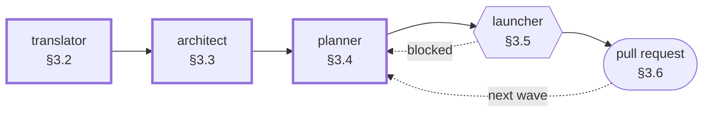

# Bootstrap Procedure


How to install the factory into a new [game repository](GLOSSARY.md#game-repository), how to drive
it, and how its first run takes an idea to a game that compiles. The factory is a template copied
into the repository — **there is no installer and no plugin** — so every step below is exact.

| § | Section | What you get |
|---|---|---|
| [1](#1-prerequisites) | Prerequisites | a machine that can run the factory |
| [2](#2-installation) | Installation | `.factory/` and `docs/` committed and pushed |
| [3](#3-using-the-factory) | Using the factory | how to run each agent, the launcher, and a feature's pull request |
| [4](#4-the-first-run) | The first run | the order of day one, from the idea to `tooling` on `main` |
| [5](#5-verification-checklist) | Verification checklist | proof the installation is sound before the first session |

The loop after day one — waves, blocks, the manual batch, bugs — is [`WORKFLOW.md`](WORKFLOW.md);
what `APPROVED` means is [`APPROVAL_PROTOCOL.md`](APPROVAL_PROTOCOL.md). Vocabulary is fixed by
[`GLOSSARY.md`](GLOSSARY.md), branches and commits by [`GIT_CONVENTIONS.md`](GIT_CONVENTIONS.md).

Commands are labelled by shell —


— and a block with both badges is the same in either. `my-game` stands for your game's directory.

---

## 1. Prerequisites

| | Requirement | Why |
|---|---|---|
| 🤖 | **Claude Code**, logged in, with `claude` on the `PATH` | you open the three gated sessions; the [factory scripts](GLOSSARY.md#factory-scripts) start the other three with `claude -p` |
| 🧠 | access to **Opus 5.5** and **Sonnet 5** | model assignment is part of the factory contract — an agent on the wrong model is a defect ([`ARCHITECTURE.md`](ARCHITECTURE.md) §3.1) |
| 🌿 | **git ≥ 2.28** | `git init -b main`, and a `git worktree` per task |
| 🐍 | **Python ≥ 3.13** | the four factory scripts; standard library only, nothing to install |
| ☁️ | an account on a **git hosting platform** | every feature ends in a pull request; the factory uses none of the platform's tools |


```bash
claude --version && git --version && python3 --version
```


```powershell
claude --version; git --version; python --version
```

Scripts are run with `python3` in bash and `python` in PowerShell throughout; substitute your
interpreter's name if it differs. They refuse to run under 3.13 and say so.

> [!WARNING]
> **The game's stack is not a prerequisite.** Its language, framework and test runner are the
> [architect](GLOSSARY.md#architect)'s decision (§3.3). Installing any of them first takes that
> decision for an agent, and usually constrains the contracts it was about to write.

---

## 2. Installation

### 2.1 Create the repository, in a folder of its own

The pipeline creates its worktrees and logs **beside** the repository — `../wt-feat-<feature>`,
`../wt-<task-id>`, `../logs/` ([`REPOSITORY_LAYOUT.md`](REPOSITORY_LAYOUT.md) §2) — so it gets a
parent folder nothing else uses. `main` is its only long-lived branch.


```bash
mkdir -p ~/games/my-game-work/my-game && cd ~/games/my-game-work/my-game
git init -b main
```


```powershell
New-Item -ItemType Directory -Force $HOME\games\my-game-work\my-game | Out-Null
Set-Location $HOME\games\my-game-work\my-game
git init -b main
```

### 2.2 Connect an empty remote

Create a repository on the platform **with nothing in it** — no README, licence or `.gitignore`, or
your first push is rejected — and connect it. You are the only one who ever talks to it: agents may
not push, pull or run `gh` ([`GIT_CONVENTIONS.md`](GIT_CONVENTIONS.md) §6).


```bash
git remote add origin <the repository's URL>
```

### 2.3 Copy the factory

Clone the factory to a scratch folder and copy the two directories that travel, whole: `.factory/`
(harnesses, scripts, empty artefact folders) and `docs/` (these documents, so you can read them
without leaving the game). Nothing else is copied — not the factory's `README.md`, and nothing else at
its root ([`REPOSITORY_LAYOUT.md`](REPOSITORY_LAYOUT.md) §2). The game repository is a copy, never a
fork or a submodule.


```bash
git clone --depth 1 https://github.com/arjperez-dev/conectium-game-factory.git /tmp/factory-src
cp -r /tmp/factory-src/.factory /tmp/factory-src/docs .
```


```powershell
git clone --depth 1 https://github.com/arjperez-dev/conectium-game-factory.git $env:TEMP\factory-src
Copy-Item -Recurse $env:TEMP\factory-src\.factory, $env:TEMP\factory-src\docs .
```

### 2.4 Confirm the template is clean

> [!IMPORTANT]
> **The step worth your attention.** A template that still holds another project's vision, task
> files, registry entries, blocked files or manual tests is silent: the first agent reads them and
> treats them as fact.

`.factory/project/`, `tasks/`, `registry/`, `blocked/` and `manual-tests/` must hold nothing but
`.gitkeep`. This lists anything else — **expected output: nothing.** Delete whatever it prints, and a
`.factory/locks/` folder if one came along, before the commit makes it permanent.


```bash
find .factory/project .factory/tasks .factory/registry .factory/blocked .factory/manual-tests \
  -type f ! -name '.gitkeep'
```


```powershell
Get-ChildItem .factory\project, .factory\tasks, .factory\registry, .factory\blocked,
  .factory\manual-tests -Recurse -File -Force | Where-Object { $_.Name -ne '.gitkeep' }
```

The six harnesses and five script files **are** the template; they are expected.

### 2.5 Commit and push

`.factory/FACTORY_VERSION` holds one semver line — the contract every artefact will be stamped with
([`REPOSITORY_LAYOUT.md`](REPOSITORY_LAYOUT.md) §4). The commit names it in its subject, so
`git log` alone answers *which version built this game?* It is `chore`, with no `Task:` footer
([`GIT_CONVENTIONS.md`](GIT_CONVENTIONS.md) §2.3).


```bash
git add -A
git commit -m "chore: install the conectium game factory v$(cat .factory/FACTORY_VERSION)"
git push -u origin main
rm -rf /tmp/factory-src
```


```powershell
git add -A
git commit -m "chore: install the conectium game factory v$(Get-Content .factory\FACTORY_VERSION)"
git push -u origin main
Remove-Item -Recurse -Force $env:TEMP\factory-src
```

Answer the checklist in §5 before the first session.

---

## 3. Using the factory

Three agents are **sessions you open** and approve; three are **started by scripts** and run
unattended. You drive both from the repository's own folder — the main checkout — which stays on
`main` for the life of the project.



> [!IMPORTANT]
> **Three rules hold in every session.**
>
> - **Approval is the literal keyword `APPROVED`**, typed by you in answer to the report that asked
>   for it. `ok`, `dale` or 👍 are feedback ([`APPROVAL_PROTOCOL.md`](APPROVAL_PROTOCOL.md) §2.1).
> - **A gated agent commits its own approved files on `main`.** You do not commit after it; you push
>   ([`GIT_CONVENTIONS.md`](GIT_CONVENTIONS.md) §2.2).
> - **Pushing, pull requests and merges into `main` are yours alone.** No agent and no script does
>   them.

### 3.1 Open a gated session

1. **Start a new Claude Code session** in the main checkout — one session, one agent, one piece of
   work.
2. **Select Opus 5.5** with `/model`, or the model picker in the desktop or web app.
3. **Paste the agent's prompt** from its section below, with the `Session:` line filled in. Paste it
   whole: it loads the harness in order — identity, rules, procedure, boundary
   ([`HARNESS_SPEC.md`](HARNESS_SPEC.md) §7.1).

Each session then passes **two gates**: gate 1 approves the work, gate 2 the exact files it will
write. Iterate as long as you like before either. `NN` in a session name is two digits — one more
than the last session of that kind under `.factory/registry/<agent>/`, or the wave number for
`wave-NN`; the agent checks it.

### 3.2 translator — the vision


Turns your idea — in Spanish or English, however rough — into `VISION.md`, asking in rounds until
nothing is ambiguous. Two answers weigh most: **content scope as numbers**, and **reference games**
as *like X, but Y*.

| Session | When | Gate 2 writes | Commit | Then |
|---|---|---|---|---|
| `first` | once per project | `VISION.md`, one registry entry per round | `docs: record the project vision` | push; open the architect |
| `revision` | only if you reopen the vision | the same, rewritten | the same | push |

```text
Read .factory/harnesses/translator/AGENT.md, then RULES.md, then PROCESS.md, then CONTEXT.md —
all under .factory/harnesses/translator/. Operate under them for this session and follow
PROCESS.md from step 1.
Session: <first | revision>. Read also: <nothing else | what the revision reopens>.
```

### 3.3 architect — the stack, the modules, the contracts


Decides the stack, cuts the game into [modules](GLOSSARY.md#module), and writes every
[contract](GLOSSARY.md#contract) with its [stub](GLOSSARY.md#stub), plus the root and module
`CLAUDE.md` files — as text, with no compiler ([`CONTRACT_SPEC.md`](CONTRACT_SPEC.md)).

| Session | When | Gate 2 writes | Commit | Then |
|---|---|---|---|---|
| `project` | once, after the translator | contracts, stubs, every `CLAUDE.md`, registry entries | `feat: add the contracts and the project facts` | push; install the runtime (§4) |
| `change-NN` | a blocked file says `needs: architect`, or you ask | the changed contracts and stubs; it also merges `main` into each open feature branch | `feat: change the <contract-id> contract` | push; the planner replans |

> [!CAUTION]
> **Read the root `CLAUDE.md` at gate 2 as carefully as anything in the factory.** Its
> `install_command`, `test_command` and `lint_command` are run by scripts, verbatim, in every
> worktree, and its module map decides what every task may touch
> ([`CONTRACT_SPEC.md`](CONTRACT_SPEC.md) §5.1).

```text
Read .factory/harnesses/architect/AGENT.md, then RULES.md, then PROCESS.md, then CONTEXT.md —
all under .factory/harnesses/architect/. Operate under them for this session and follow
PROCESS.md from step 1.
Session: <project | change-NN>. Read also: <nothing else | the blocked files, by path>.
```

### 3.4 planner — the waves of task files


Cuts the work into [task files](GLOSSARY.md#task-file) — each carrying its code, interfaces and
test names — one [wave](GLOSSARY.md#wave) at a time, against the code as it stands
([`TASK_FILE_SPEC.md`](TASK_FILE_SPEC.md)).

| Session | When | Gate 2 writes | Commit | Then |
|---|---|---|---|---|
| `wave-NN` | the next wave is due; the first, `wave-01`, writes waves 0 and 1 | the wave's task files, registry entries | `docs: plan wave <N>` | push; run the launcher |
| `replan-NN` | after a blocked file, a contract change, or a failed manual test | rewritten, new or deleted task files; each `blocked → pending` | `docs: replan <NN>` | push; run the launcher |

> [!IMPORTANT]
> **Gate 2 is where you make the check nothing else makes:** no file appears in the `files` of two
> tasks that could run at the same time ([`TASK_FILE_SPEC.md`](TASK_FILE_SPEC.md) §6.5). Two live
> tasks writing one file conflict when the second integrates.

```text
Read .factory/harnesses/planner/AGENT.md, then RULES.md, then PROCESS.md, then CONTEXT.md —
all under .factory/harnesses/planner/. Operate under them for this session and follow
PROCESS.md from step 1.
Session: <wave-NN | replan-NN>. Read also: <nothing else | the blocked files and manual tests, by path>.
```

### 3.5 The launcher and the unattended agents

The implementer, its tester and the integrator are never opened by hand. You run the scripts; the
scripts start the agents, non-interactively, with their model and a tool list that denies pushing,
pulling, rebasing and `gh`.

| Agent | Started by | Model | Does |
|---|---|---|---|
|  | `launch.py`, per attempt | Sonnet 5; Opus 5.5 on the third | builds one task in its own worktree until `verify-task` passes |
|  | the implementer, by name | Sonnet 5 | says what the tests miss; writes the manual test |
|  | `integrate.py`, per task and per feature | Sonnet 5 | merges the task into its feature, runs the whole suite, writes the commit and `pr.md` |

| To |  |  |
|---|---|---|
| see what could start now | `python3 .factory/scripts/dispatch.py` | `python .factory/scripts/dispatch.py` |
| see the whole plan, by status | `python3 .factory/scripts/dispatch.py --status` | `python .factory/scripts/dispatch.py --status` |
| run every ready task until nothing is left | `python3 .factory/scripts/launch.py` | `python .factory/scripts/launch.py` |
| the same, with N implementers instead of three | `python3 .factory/scripts/launch.py --max N` | `python .factory/scripts/launch.py --max N` |

The launcher prints a line as each task starts and ends, and a summary when nothing is left.
`integrated` needs nothing from you. **`blocked`** means a
[blocked file](GLOSSARY.md#blocked-file) under `.factory/blocked/<feature>/` names whom to summon —
the planner or the architect. Every other line, and what to do about it, is
[`WORKFLOW.md`](WORKFLOW.md) §2.6. Each session's output is in `../logs/`.

### 3.6 A feature's pull request

A feature's pull request is opened when **every task of it is `integrated`** and **its manual batch
has passed** ([`GIT_CONVENTIONS.md`](GIT_CONVENTIONS.md) §5.1; the batch is
[`WORKFLOW.md`](WORKFLOW.md) §2.9). The integrator has written its body to
`.factory/registry/integrator/<feature>/pr.md` — or `pr-02.md` and on after a bug; use the latest.

**1 · Record the factory's state and push both branches.**


```bash
git add .factory && git commit -m "chore: record the factory state"
git push
git push -u origin feat/<feature>
```

**2 · Open it on the platform** — base `main`, head `feat/<feature>`. The **title** is the `Outcome`
line of `pr.md`; the **body** is its fenced block under `Evidence`, verbatim.

**3 · Merge it with a merge commit.**

> [!WARNING]
> **Never squash, never rebase.** The task merges inside it carry the `Task:` footers the history is
> traced by ([`GIT_CONVENTIONS.md`](GIT_CONVENTIONS.md) §5.4).

**4 · Pull, and clean up.** Delete the branch on the platform, then:


```bash
git pull --ff-only
git worktree remove ../wt-feat-<feature>
git branch -d feat/<feature>
```

**The pull is the step nothing else does for you**: the launcher cuts every feature from the local
`main`, and no agent may pull. If `--ff-only` refuses, a gated session committed while the pull
request was open — run `git pull --no-rebase`, a merge and never a rebase. If `worktree remove`
refuses over build output, add `--force`; everything the feature holds is on `main` now.

---

## 4. The first run

Day one runs §3 in a fixed order and ends with a game that compiles.

| # | Step | Details |
|---|---|---|
| 1 | **translator**, `Session: first` | §3.2 — then push |
| 2 | **architect**, `Session: project` | §3.3 — a new session, not the translator's; then push |
| 3 | **Install the stack's runtime** | the language and package manager the root `CLAUDE.md` names under `Stack`, at those versions — Node.js and npm for TypeScript, say. **Nothing else**: the game's own dependencies arrive with wave 0 through `install_command`, and an unattended implementer has no network to install anything ([`CONTEXT_POLICY.md`](CONTEXT_POLICY.md) §5.4) |
| 4 | **planner**, `Session: wave-01` | §3.4 — writes **wave 0**, the `tooling` feature (manifest, language configuration, linter, formatter, test runner, build, as `scaffolding` tasks), and **wave 1**; then push |
| 5 | **Launch** | §3.5 — **only `tooling` runs.** No other feature branch is cut until `tooling` is on `main` ([`GIT_CONVENTIONS.md`](GIT_CONVENTIONS.md) §1.4), so the summary ends with `waiting for feature tooling to reach main` |
| 6 | **The pull request of `tooling`** | §3.6 — it rarely has a manual test; run any that `.factory/manual-tests/tooling/` holds first |

> [!TIP]
> **Day one is done** when `tooling` is on `main` and your local `main` is pulled: the vision, the
> contracts, the stubs and the tooling are there, the suite runs green, and wave 1 is planned and
> waiting. Run the launcher again and it starts, in parallel — [`WORKFLOW.md`](WORKFLOW.md) takes it
> from there.

---

## 5. Verification checklist

Answer every item yes before the translator session — each is cheap to fix now and expensive once a
project's artefacts sit on top of it.

```markdown
Tooling
- [ ] `claude --version` runs, and Claude Code is logged in.
- [ ] Opus 5.5 and Sonnet 5 are both selectable in Claude Code.
- [ ] git reports 2.28 or newer, and Python 3.13 or newer.

Installation
- [ ] The repository sits in a parent folder of its own, and its branch is `main`.
- [ ] `origin` points at an empty repository on the hosting platform.
- [ ] `.factory/` holds `FACTORY_VERSION`, `.gitignore`, `scripts/` and six harnesses; `docs/` holds its twelve documents and `README.md`.
- [ ] No `README.md` was copied from the factory.

The template is clean
- [ ] The §2.4 command printed nothing, and no `.factory/locks/` folder exists.

Committed
- [ ] `git log` shows exactly one commit, on `main`, whose subject names the factory version.
- [ ] `git status` is clean, and up to date with `origin/main`.
```
