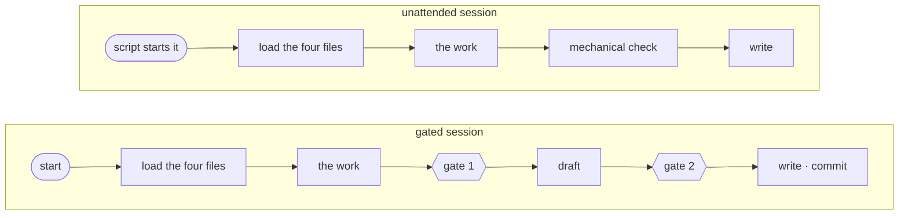

# Harness Specification

A [harness](GLOSSARY.md#harness) is everything that surrounds one [agent](GLOSSARY.md#agent): its
identity, its rules, its process, its boundaries and its templates. This document fixes the shape
every harness follows. There are **two shapes**, one for the three agents with
[approval gates](GLOSSARY.md#approval-gate) and one for the three without, and within a shape the
harnesses are **identical in structure and differ only in content**.

Uniformity is deliberate. It makes the factory predictable to operate — an operator who has read
one gated harness knows where the gates are in the other two — auditable, because a reviewer knows
where to look before opening a file, and extensible to a seventh agent without redesign (§8.2).

Vocabulary is fixed by [`GLOSSARY.md`](GLOSSARY.md); paths by
[`REPOSITORY_LAYOUT.md`](REPOSITORY_LAYOUT.md); gates, [reports](GLOSSARY.md#report) and
[blocked files](GLOSSARY.md#blocked-file) by [`APPROVAL_PROTOCOL.md`](APPROVAL_PROTOCOL.md); the
[task file](GLOSSARY.md#task-file) by [`TASK_FILE_SPEC.md`](TASK_FILE_SPEC.md);
[registries](GLOSSARY.md#registry) by [`REGISTRY_SPEC.md`](REGISTRY_SPEC.md); what each agent may
read, write and run by [`CONTEXT_POLICY.md`](CONTEXT_POLICY.md); git by
[`GIT_CONVENTIONS.md`](GIT_CONVENTIONS.md).

**This document specifies structure, never content.** What the translator asks, how the implementer
adapts an implementation, what the integrator's commit message says — none of that is here. What is
here is that every gated `PROCESS.md` has its gates in the same places, and every unattended one
ends the same way.

---

## 1. The two shapes

### 1.1 The tree

```text
.factory/harnesses/<agent>/
  AGENT.md          # identity, role, assigned model, factory version
  RULES.md          # hard rules and prohibitions
  PROCESS.md        # the steps of one session, from its input to its last write
  CONTEXT.md        # what this agent may read, write and run — the hard boundary
  OUTPUT.md         # the exhaustive write set, and the shape of every artefact in it
  CHECKLIST.md      # the definition of done before each gate — gated harnesses only
  templates/        # one template per artefact this agent writes
```

| Entry | Purpose | Owned by |
|---|---|---|
| `AGENT.md` | Who you are: role in the second person, what you produce, capabilities, what is explicitly not yours, and the harness's identity block | §3.1 |
| `RULES.md` | What you must and must not do, numbered so a rule can be cited, checkable so a person can verify it | §3.2, §4 |
| `PROCESS.md` | The ordered steps of one [session](GLOSSARY.md#session): where its input is, what to check in it, the work, the writes, how it ends and how it stops | §3.3 |
| `CONTEXT.md` | This agent's column of `CONTEXT_POLICY.md`, and the instruction to stop rather than reach past it | §3.4 |
| `OUTPUT.md` | Every path this agent may write, the frontmatter and body of each artefact, the status transitions and the git writes it owns | §3.5 |
| `CHECKLIST.md` | Two definitions of done — the work, before gate 1; the write set, before gate 2 | §3.6 |
| `templates/` | One template per [artefact](GLOSSARY.md#artefact) this agent writes, `registry-entry.md` included | §5 |

| | Gated<br/>`translator` · `architect` · `planner` | Unattended<br/>`implementer` · `tester` · `integrator` |
|---|---|---|
| `AGENT.md`, `RULES.md`, `PROCESS.md`, `CONTEXT.md`, `OUTPUT.md` | ✓ | ✓ |
| `CHECKLIST.md` | ✓ | **does not exist** |
| `templates/` | ✓ | ✓ |
| | **6 files and a directory** | **5 files and a directory** |

**No artefact lives inside a harness.** A harness holds what constrains its agent, never what its
agent produces; every artefact is under `.factory/` at the path
[`REPOSITORY_LAYOUT.md`](REPOSITORY_LAYOUT.md) §2 gives it. §6 says what left the harness in
`4.0.0`, and why.

### 1.2 Why two shapes

Until `4.0.0` all five harnesses were identical, and uniformity was the point. It gives way here on
purpose: three agents have gates and three do not, and a `CHECKLIST.md` exists to be verified
immediately before a gate. In a harness with no gate it would be a file with no moment, checked
against nothing — the drift a uniform skeleton exists to prevent, installed in the name of
uniformity.

So the line is drawn by the one property that changes what a session is. A gated agent works in
front of a person and stops twice for `APPROVED`; an unattended agent is started by a script, stops
for nobody, and is checked by what comes after it
([`APPROVAL_PROTOCOL.md`](APPROVAL_PROTOCOL.md) §1.4). Everything else about the two shapes is the
same.

**`INPUT.md` no longer exists in either shape.** Every agent has one input at a fixed path — the
operator in conversation, a task file, the gated sessions' own directories — and saying where it is
and what to check takes a few steps at the top of `PROCESS.md`. A file for them was a file loaded
at every session start to say ten lines.

### 1.3 Why several files and not one

A single `HARNESS.md` carrying all of it would be one file to open and one to keep consistent, and
it is rejected for the reason that has held since `1.0.0`: **each file has exactly one moment.**
`OUTPUT.md` is read when the write set is drafted, `CHECKLIST.md` immediately before each gate, the
templates while an artefact is filled in. A file that answers one question at one moment can be
verified against that moment. A merged document is verified against nothing in particular, and
drifts section by section.

### 1.4 What is identical, and what differs

| Identical within a shape | Differs per harness |
|---|---|
| the tree of §1.1, file for file | the content of every file |
| the sections of every file, and their order (§3) | what fills those sections |
| rules 1–6 of `RULES.md`, wording **and** numbering, in all six (§4.1) | the agent's own rules |
| rules 10–14, wording and numbering, in the three gated harnesses (§4.2) | |
| the sections of `PROCESS.md` | the steps inside `The work` |
| the two blocks of `CHECKLIST.md`, and the minimum items of the second (§3.6) | the items of the first |
| the citation form for protocol documents (§2.2) | which documents are cited |

"Structurally interchangeable" is meant literally: a reviewer diffing two gated `RULES.md` files sees
identical text through rule 14, and two unattended ones identical text through rule 6.

---

## 2. Rules that hold for every harness

### 2.1 Second person, imperative

A harness file is addressed **to the agent that runs under it**, so it is written in the second
person and the imperative: *You are the tester*, *Read the task file the launch prompt names*,
*Never push*. The documents under `docs/` are specifications and are written in the third person;
harness files are instructions and are not.

The distinction is not stylistic. Prose that describes what an agent does reads as background;
prose that tells it what to do reads as an instruction, and a rule that reads as background is a
rule that gets weighed against the work instead of applied to it.

### 2.2 Reference, never restate

**A harness never restates a protocol.** It names the document and the section, and stops. Six
copies of a rule are six chances for the wording to drift, and the drift is invisible: each copy
looks authoritative in the file it sits in.

The citation form is a repository-relative path in backticks, plus a section number:

```text
See `docs/APPROVAL_PROTOCOL.md` §5.5.
```

The agent reads the section a citation names, and only that section — the grant is
[`CONTEXT_POLICY.md`](CONTEXT_POLICY.md) §2.1.

Never a markdown link. A relative link from inside a harness is `../../../docs/…`, which is fragile,
unreadable, and the first thing to break when the layout is packaged as a plugin (§8.3).
Repository-relative is also what stays true after `.factory/` and `docs/` are copied into a
[game repository](GLOSSARY.md#game-repository) side by side.

**Two deliberate exceptions**, and only two: the six cross-cutting rules are copied verbatim into
every `RULES.md` (§4.1), and the five gate rules into every gated one (§4.2). A rule an agent must
obey without looking anything up has to be in front of it.

### 2.3 A section that does not apply is stated, never deleted

Every file carries every section §3 requires for its shape, in order. Where a section has nothing to
say, it says so and gives the reason: an absent section and a section saying *none, because…* read
differently to a person. One says nothing was needed; the other says nobody considered the
question.

Four asymmetries are known in advance, and none is an exception to this rule:

| Harness | File | The asymmetry | What the section states |
|---|---|---|---|
| [`translator`](GLOSSARY.md#translator) | `PROCESS.md` | no artefact is its input | the input is the [operator](GLOSSARY.md#human-operator) in conversation |
| `translator`, [`architect`](GLOSSARY.md#architect) | `OUTPUT.md` | they own no status transition | none: no task exists when the translator runs, and a contract change reaches task status only through the planner |
| [`tester`](GLOSSARY.md#tester) | `OUTPUT.md` | its manual test is conditional, and it makes no git write | the write set in both cases — with and without a `Manual check` — and that git is the implementer's |
| [`integrator`](GLOSSARY.md#integrator) | `PROCESS.md` | it runs two kinds of session | a task integration and a feature close, each with its own steps inside `The work` |

### 2.4 Numbering

**Rule numbers are stable across harnesses.** Rule 4 is the contract rule in all six, so
`RULES.md #4` means one thing in the factory.

| Numbers | Hold | In |
|---|---|---|
| 1–6 | the cross-cutting rules | all six harnesses |
| 7–9 | nothing — retired in `4.0.0`, never reused | — |
| 10–14 | the gate rules | the three gated harnesses |
| 15 upward | the agent's own rules | the three gated harnesses |
| 10 upward | the agent's own rules | the three unattended harnesses |

Numbers 7 to 9 stay empty so that the gate rules keep, in every gated harness, the numbers
[`APPROVAL_PROTOCOL.md`](APPROVAL_PROTOCOL.md) §7 gives them. The sequence of an agent's own rules never restarts
between `Musts` and `Must-nots`: a rule is identified by its number alone.

**Step numbers are continuous within a `PROCESS.md` and are not comparable across harnesses.** `The
work` is a different length in each, so step 6 is not the same step everywhere, and no document ever
cites a step number without naming its harness.

### 2.5 No line budget

Until `4.0.0` the four files loaded at session start had to stay under 400 lines together. **There
is no such budget any more.** A cap on a harness's length trims the text a model reasons from, and
where the text is right, less of it is less judgement, not less cost worth saving.

What the budget actually policed was one defect — a protocol restated instead of referenced — and
that defect has its own rule (§2.2) and its own item in the conformance checklist (§9). A harness
that has grown long is checked for copies of `docs/`, not for its line count.

### 2.6 Language

Technical English throughout, in every harness file and every template — including the
translator's, whose input may arrive in Spanish. Identifiers, paths, frontmatter values and the
approval keyword are English ([`APPROVAL_PROTOCOL.md`](APPROVAL_PROTOCOL.md) §2.1), and a harness
written in one language that produces artefacts in another has a translation step nobody maintains.

---

## 3. The files

### 3.1 `AGENT.md`

Opens with a YAML frontmatter block, the only machine-readable thing in a harness:

```yaml
---
agent: implementer
model: Sonnet 5
level: task
cadence: once per task; relaunched on Opus 5.5 when escalated
factory_version: 4.0.0
---
```

| Field | Value |
|---|---|
| `agent` | the agent name, lowercase, identical to its directory name |
| `model` | the assigned model, verbatim from [`ARCHITECTURE.md`](ARCHITECTURE.md) §3.1 — `Opus 5.5` or `Sonnet 5` |
| `level` | the [level](GLOSSARY.md#level) the agent works at: `project`, `wave` or `task` |
| `cadence` | how often it runs, in one phrase |
| `factory_version` | the version this harness text was written for — §8.1 |

Where an agent works at a second level — the integrator closing a feature, the architect changing a
contract after the project has started — `level` records the primary and `PROCESS.md` names the
other.

| Order | Section | Must contain |
|---|---|---|
| 1 | `# <agent>` | the title line, nothing else |
| 2 | `## Role` | one paragraph in the second person, opening *You are the `<agent>`*. What the agent is **for** — never how it works |
| 3 | `## What you produce` | one line per artefact, by name. **No paths** — `OUTPUT.md` owns those |
| 4 | `## Capabilities` | what this agent is equipped to do, including the tools it runs — the test runner, git, the terminal. What it may *read* belongs to `CONTEXT.md` and is referenced, not repeated |
| 5 | `## Not your responsibility` | one line per item, each naming the agent, the script or the person that owns it instead. An entry that does not name an owner is an opinion, not a boundary |
| 6 | `## Where to look` | the map of this harness, one line per file, with the moment each is read |

`Not your responsibility` is the section that earns the file. Every agent sits next to work adjacent
to its own and within reach — the implementer can see the shared file the task needs, the integrator
can see how to fix the task that broke the suite, the planner can see the contract that falls short.
Naming the owner is what makes the boundary resolvable at the moment of temptation.

### 3.2 `RULES.md`

| Order | Section | Gated | Unattended |
|---|---|---|---|
| 1 | `# <agent> — rules` + preamble | three sentences: these are hard rules; every rule is checkable by a person (§4.4); where a rule and a document under `docs/` disagree, **the document wins and this harness has a defect worth reporting** | the same |
| 2 | `## 1. Cross-cutting rules` | rules **1–6 of §4.1, verbatim** | the same |
| 3 | `## 2. Gate rules` | rules **10–14 of §4.2, verbatim** | — |
| 4 | `## 2. Musts` or `## 3. Musts` | the agent's own obligations, from 15 | its own obligations, from 10 |
| 5 | `## 3. Must-nots` or `## 4. Must-nots` | the agent's own prohibitions, continuing the sequence | the same |

Nothing else. `RULES.md` carries no procedure and no examples of good work — those are `PROCESS.md`'s
and the templates' respectively. A rules file that argues for its rules is a rules file nobody
finishes reading.

### 3.3 `PROCESS.md`

Steps are numbered continuously from 1 through the whole file (§2.4).

**A gated `PROCESS.md`** has eight sections, in this order:

| Order | Section | Contents | Varies? |
|---|---|---|---|
| 1 | `## Session start` | confirm the session runs the model in `AGENT.md`; say which kind of session this is; where the input is and what it must carry; compare `AGENT.md`'s `factory_version` against `.factory/FACTORY_VERSION` (§8.1) | the input, and the kinds of session |
| 2 | `## The work` | the agent's own steps. States that iteration here is unlimited and expected — `docs/APPROVAL_PROTOCOL.md` §1.2 | **the agent's own** |
| 3 | `## Gate 1` | verify the `Work` block of `CHECKLIST.md`; file a work report; wait | fixed |
| 4 | `## Draft the write set` | read `OUTPUT.md`; draft every artefact from its template; **write nothing to disk** | fixed |
| 5 | `## Gate 2` | verify the `Write set` block of `CHECKLIST.md`; file a write-set report; wait | fixed |
| 6 | `## Write and commit` | write exactly the approved paths; stage them by path and commit them on `main` — `docs/GIT_CONVENTIONS.md` §2.2 | fixed in order, agent-specific in content |
| 7 | `## Session end` | state in chat what was written and committed, and in one line what the operator does next | fixed |
| 8 | `## If you must block` | the blocked report, by reference to `docs/APPROVAL_PROTOCOL.md` §5.1–§5.4; produce nothing; blocking is available at every step | fixed |

The two gate sections carry the canonical lines of
[`APPROVAL_PROTOCOL.md`](APPROVAL_PROTOCOL.md) §7 and nothing more:

```text
Gate 1 — file a work report and wait. See `docs/APPROVAL_PROTOCOL.md` §4.1.
Gate 2 — file a write-set report and wait. See `docs/APPROVAL_PROTOCOL.md` §4.2.
```

**An unattended `PROCESS.md`** has five sections, in this order:

| Order | Section | Contents | Varies? |
|---|---|---|---|
| 1 | `## Session start` | what the launch prompt gives you; read the task file in the main checkout and stop if it is malformed — `docs/TASK_FILE_SPEC.md` §7.1–§7.2; compare `AGENT.md`'s `factory_version` against `.factory/FACTORY_VERSION` (§8.1) | the input |
| 2 | `## The work` | the agent's own steps | **the agent's own** |
| 3 | `## Write` | the writes of a session that finished, in order | agent-specific in content |
| 4 | `## Session end` | end the session; say nothing more than one line of what was written, for the log | fixed |
| 5 | `## If you must block` | how this seat stops — `docs/APPROVAL_PROTOCOL.md` §5.5 for the implementer and the integrator, a report to the implementer for the tester | fixed per seat |

Nobody reads an unattended session as it runs, so it has no gates, no report and nobody to wait for.
What it has instead is an order of writes that leaves the factory readable if the session dies
between any two of them.

**A status line is written after the artefact that justifies it**, never before. A blocked file is
written, then the task is set `blocked`; a gated session writes its files, then commits them. A
session interrupted between the two leaves an artefact without a status, which a person can see and
finish, rather than a status claiming an artefact that was never written.

### 3.4 `CONTEXT.md`

| Order | Section | Must contain |
|---|---|---|
| 1 | `# <agent> — context boundary` + preamble | the baseline rule of `docs/CONTEXT_POLICY.md` §1, and that this file **derives from that document and never widens it**; where they differ, the policy wins |
| 2 | `## Allowed` | a table of resource · condition · why, one row per ✓ or ○ in this agent's column of the read matrix |
| 3 | `## Denied` | the denials that matter for this agent, each with its one-line reason |
| 4 | `## Writing` | this agent's row of `docs/CONTEXT_POLICY.md` §3.1, and where each write goes: the main checkout or a worktree |
| 5 | `## Git and the terminal` | the git reads and writes this agent makes — §4 of the policy; that the terminal widens nothing — §5; the network, if this agent has any |
| 6 | `## If you need something outside this boundary` | how this seat stops — `docs/CONTEXT_POLICY.md` §6. Never read first and mention it afterwards |

The `why` column is not decoration. A boundary that looks arbitrary is the first one an agent
reasons its way past, and the one line saying what it protects is what makes it hold.

### 3.5 `OUTPUT.md`

| Order | Section | Must contain |
|---|---|---|
| 1 | `# <agent> — output` + one line | in a gated harness, that nothing here is written before gate 2 is approved; in an unattended one, when in the session each write happens |
| 2 | `## The write set` | **the exhaustive table** — every path this harness may ever write. Columns: path · artefact · template · written when |
| 3 | `## Frontmatter` | the fields and values of each artefact written, or `none` with the reason |
| 4 | `## Body structure` | the sections of each artefact, in order, and the template that carries them |
| 5 | `## Status transitions you own` | from `docs/TASK_FILE_SPEC.md` §5.1, or `none` with the reason |
| 6 | `## Git writes you make` | from `docs/CONTEXT_POLICY.md` §4.2 and `docs/GIT_CONVENTIONS.md`, or `none` with the reason |
| 7 | `## What never goes in` | the things most likely to be misfiled by this agent, and where each belongs instead |

**The write-set table is what rule 3 points at** for a gated agent, and what bounds the agent's
factory artefacts for an unattended one; the code an implementer writes is bounded by its task file
and the file gradient instead. A path that is not in this table is a path the harness does not
authorise.

`What never goes in` feeds the *Deliberately omitted* block of the gate-2 report in a gated harness,
and in an unattended one it is the only warning an agent gets before it misfiles something nobody
will read until the pull request.

### 3.6 `CHECKLIST.md` — gated harnesses only

| Order | Section | Must contain |
|---|---|---|
| 1 | `# <agent> — definition of done` + preamble | every item is answerable yes or no by the operator; **a satisfied checklist is not approval** (`docs/APPROVAL_PROTOCOL.md` §3); the count reported at gate 1 covers the `Work` block only |
| 2 | `## Work — verified before gate 1` | the agent's own checkboxes: the work is complete, by this agent's own definition |
| 3 | `## Write set — verified before gate 2` | the minimum items below, plus anything the agent needs |

The second block carries at least these, in every gated harness:

```markdown
- [ ] Every path I will write, rewrite or delete appears in the gate-2 report table, and no other.
- [ ] Every path rewritten in place or deleted carries its rewrite preview.
- [ ] Every artefact follows its template, and carries `factory_version` read from `.factory/FACTORY_VERSION`.
- [ ] Every registry entry carries all five fields and fits 15 lines.
- [ ] I claim no status transition this harness does not own.
- [ ] The commit stages exactly these paths, by path, never with `git add -A`.
- [ ] The report is at most 40 lines, the previews aside.
```

Two blocks rather than one, because the two gates check different things: gate 1 approves the work,
gate 2 approves what reaches disk, and they fail in different ways
([`APPROVAL_PROTOCOL.md`](APPROVAL_PROTOCOL.md) §1.1).

An unattended agent has no checklist because nothing reads one. What stands where its gates would be
is mechanical — `verify-task`, the suite after every merge — and it is in `PROCESS.md` as a step,
because a step is what an unattended agent executes.

---

## 4. The rules every harness carries

### 4.1 The six cross-cutting rules

Every `RULES.md` opens with these, **copied verbatim**, in this order, with this numbering:

```markdown
1. Never open a pull request, never merge into `main` and never push. All three belong to the
   human operator.
2. Never improvise around a missing, malformed or contradictory input. Stop, and say why in the
   form `docs/APPROVAL_PROTOCOL.md` §5 gives your seat.
3. Never write outside the paths your seat authorises: the write set your gate-2 report named if
   you have gates, the bounds `docs/CONTEXT_POLICY.md` §3.1 gives you if you do not.
4. Never edit a contract. Contracts belong to the architect, and a change to one is approved by
   the human operator.
5. Never write the `status` of a task other than `blocked`. The scripts write every other
   transition.
6. Never decide that replanning happens. Say what you found and stop.
```

Each is written to be true of all six seats, and that is harder than it looks. Rule 2 does not say
*write a blocked file*, because three agents have a person in front of them and stop in chat; rule 3
does not say *the paths this task authorises*, because three agents have no task. A rule that is
false for one seat teaches that seat that the rules are approximate.

**Wording that differs from the block above is wrong by definition.** A harness that improves a
rule has produced a rule that means something slightly different in one of six places, which is the
failure the verbatim requirement exists to prevent.

### 4.2 The five gate rules

Every gated `RULES.md` carries rules 10–14 of [`APPROVAL_PROTOCOL.md`](APPROVAL_PROTOCOL.md) §7,
**copied verbatim** from there, under `## 2. Gate rules`. They are not reproduced here: that section
is their one source, and a second copy in this document would be a third place for them to drift.
No unattended harness carries them.

### 4.3 The two declared exceptions

Two agents do something a cross-cutting rule appears to forbid. Neither may edit the rule. Each
states its exception as its first own rule, numbered 15, citing where it is granted:

| Harness | Rule | The exception, and where it is granted |
|---|---|---|
| [`architect`](GLOSSARY.md#architect) | 4 | It writes and changes contracts, under its two gates, because contracts are its own. `docs/CONTRACT_SPEC.md` §6 |
| [`planner`](GLOSSARY.md#planner) | 5 | It returns a `blocked` task to `pending` when it replans that task, because replanning is its own. `docs/TASK_FILE_SPEC.md` §5.1 |

Stating an exception beside the rule, rather than inside it, keeps the rule diffable across six
files and keeps the exception visible: a rule numbered 15 reads as this agent's own, which is exactly
what it is.

The integrator writes no status at all: `integrated` is written by the integration script once it
finds the merge commit ([`TASK_FILE_SPEC.md`](TASK_FILE_SPEC.md) §5.1). That is why rule 5 needs no
third exception.

### 4.4 What makes a rule checkable

Every rule — the shared ones and each agent's own — must be **checkable by a person**: the operator
can answer yes or no about a finished session from its transcript or log, its writes and its commits
alone, without asking the agent what it meant.

| Not checkable | Checkable |
|---|---|
| Keep the vision faithful to the client's intent. | Never write a field into `VISION.md` the operator did not confirm in this session. |
| Test thoroughly. | Name every acceptance criterion the tests do not reach, in your registry entry. |
| Respect the plan. | Never change a line of a task file other than `status`. |
| Keep the commit message clean. | Never write a subject longer than 72 characters, type and scope included. |

The left column is not weaker advice; it is not a rule at all. It cannot be violated visibly, so it
cannot be enforced, and every unenforceable line in a rules file dilutes the ones that are.

---

## 5. `templates/`

**Every artefact in the `OUTPUT.md` write set has a template**, and every harness carries
`registry-entry.md`. The registry template is one template across the factory
([`REGISTRY_SPEC.md`](REGISTRY_SPEC.md) §3.1) and only its `Evidence` line is agent-specific
(§3.4); the per-harness copy exists to carry that line.

| Rule | |
|---|---|
| **Naming** | kebab-case, named for the artefact: `task.md`, `bug.md`, `blocked-file.md`, `manual-test.md`, `commit-message.md`, `pr-body.md`, `registry-entry.md` |
| **Placeholders** | values to be replaced are in `<angle brackets>`; frontmatter is present, with placeholder values, so a missing field is visible as a gap rather than an absence |
| **Contents** | **a template contains only what the finished artefact contains.** Guidance about how to fill it lives in `OUTPUT.md` |
| **Status** | a template is read-only infrastructure. An agent fills a copy; it never writes to a template, and a template is not an artefact |
| **Change** | templates are tracked in git, and changing one changes a factory contract — a MINOR or MAJOR bump under [`REPOSITORY_LAYOUT.md`](REPOSITORY_LAYOUT.md) §4 |

**Two harnesses may carry the same template.** The implementer and the integrator both write blocked
files, so both carry `blocked-file.md`. Each copy is its own harness's text, which is what keeps any
harness from reading another's (§8.3). The copies must agree, and the conformance pass diffs them.

The contents rule is the one that gets broken. A template with a helpful `<!-- keep this under three
sentences -->` in it produces artefacts carrying that comment, because the agent filling it in is
copying a file, not reading a manual.

**A contract has no template**, and neither does a stub: both are code in the game's language, and
their shape is [`CONTRACT_SPEC.md`](CONTRACT_SPEC.md)'s. The architect's templates are its
`CLAUDE.md` files and its registry entry.

---

## 6. What left the harness in `4.0.0`

Until `4.0.0` a harness also held three directories. None of them survives.

| Directory | Held | Why it is gone |
|---|---|---|
| `handoffs/` | the handoffs addressed to this agent, keyed by reader | one handoff is left — the task file — and it lives in `.factory/tasks/`, where N agents and the scripts read it ([`TASK_FILE_SPEC.md`](TASK_FILE_SPEC.md) §1.1) |
| `registry/` | this agent's own registry, keyed by writer | one entry per file, at `.factory/registry/<agent>/…`, so that N agents writing about N tasks never share a file ([`REGISTRY_SPEC.md`](REGISTRY_SPEC.md) §2) |
| `docs/` | agent-specific reference material | it was empty in every harness from `1.0.0` to `3.0.1`. A directory kept for material nobody wrote is six `.gitkeep` files to maintain and a place for a copy of `docs/` to appear |

Keeping artefacts out of the harness is what makes a harness pure instruction: its text can be read,
diffed and packaged without anything a project wrote getting in the way, and the read boundary lives
in `CONTEXT.md` rather than in which directory a file happens to sit in.

---

## 7. Sessions

### 7.1 How a session starts

Every session loads four files before any work, in this order:

```text
AGENT.md → RULES.md → PROCESS.md → CONTEXT.md
```

Identity, then constraints, then procedure, then boundary — each one framing the next. The input is
read at the first steps of `PROCESS.md`. `OUTPUT.md` and the templates are read when the writes are
drafted; `CHECKLIST.md` immediately before each gate.

| | Gated session | Unattended session |
|---|---|---|
| Started by | the operator, in a new Claude Code session, with the model named in `AGENT.md` | a factory script, non-interactively — [`GLOSSARY.md`](GLOSSARY.md#factory-scripts) |
| Told to load its harness by | the prompt the operator pastes, from `docs/BOOTSTRAP.md` | the prompt in the script: `launch.py` for the implementer and the tester, `integrate.py` for the integrator |
| Told its input by | the operator | the prompt: the task id, the path of the task file, the main checkout and its working directory |
| Tools | the operator answers permission prompts | a fixed list the script passes, with pushing, pulling, fetching, rebasing and `gh` denied outright — [`CONTEXT_POLICY.md`](CONTEXT_POLICY.md) §5.2 |



**The tester is started by name.** It runs as a subagent inside the implementer's session, which the
launcher starts with the tester defined through Claude Code's `--agents` option. The implementer asks
for `tester`; nothing in its harness names a path into the tester's (§8.3).

### 7.2 One task per session

An unattended session handles exactly one [task](GLOSSARY.md#task), and a gated session exactly the
session kind it was opened for — one round of the vision, one wave, one replanning, one contract
change. An agent does not open, chain or resume a session, and it never begins a second piece of
work because the first went quickly.

### 7.3 Effort levels are undefined

No harness specifies one. They are a tuning parameter, and tuning before the parallel pipeline has
run a game would be guesswork. A harness that sets one has invented a contract this document does not
carry.

### 7.4 The prompts belong elsewhere

This section fixes the convention. The text the operator pastes to open a gated session is rendered
once, in `docs/BOOTSTRAP.md`; the prompts of the unattended sessions live in the scripts that send
them. Neither is repeated in any harness.

---

## 8. Versioning, adding an agent, plugin readiness

### 8.1 One version, and what `AGENT.md` records

Harnesses are **not versioned individually**. The factory carries one global
[version](GLOSSARY.md#factory-version) at `.factory/FACTORY_VERSION`, covering all six, because the
six share one factory contract ([`REPOSITORY_LAYOUT.md`](REPOSITORY_LAYOUT.md) §4).

`AGENT.md` carries a `factory_version` field, a second copy of that number. Four sentences govern
it:

- **`.factory/FACTORY_VERSION` is authoritative.** The field records the version this harness text
  was written for.
- **Every artefact is stamped from the file, never from the field.** An agent reading it out of its
  own harness would stamp the version the harness has carried since it was written.
- **A mismatch is mentioned and never blocks.** A gated agent mentions it in its gate-1 report, an
  unattended one in the one line that ends its session. It says the harness text predates the
  current factory contract — worth knowing, and not a defect in the input.
- **Bumping `FACTORY_VERSION` updates the field in all six `AGENT.md` files, in the same change.**

The duplication is deliberate on those terms. A version recorded only in a shared file cannot tell
you that one harness was left behind; a version recorded in the harness can, provided nothing ever
*acts* on it.

### 8.2 Adding a seventh agent

The procedure, in order:

1. **Decide the role**: its level, model, cadence, and whether it has gates — which decides its
   shape. [`ARCHITECTURE.md`](ARCHITECTURE.md) §3.
2. **Name it**: an entry under Roles in [`GLOSSARY.md`](GLOSSARY.md).
3. **Give it a boundary**: a column in the read matrix of [`CONTEXT_POLICY.md`](CONTEXT_POLICY.md)
   §2.1, a row in §3.1, and its git in §4.
4. **Give it a registry**: rows in [`REGISTRY_SPEC.md`](REGISTRY_SPEC.md) §2.3, §3.3 and §3.4.
5. **Give it a transition, if it owns one**: a row in [`TASK_FILE_SPEC.md`](TASK_FILE_SPEC.md) §5.1,
   and remove it from whoever held it — every transition has exactly one owner. An agent can own
   only `blocked` without a declared exception to rule 5.
6. **Build the harness**: `.factory/harnesses/<agent>/` in its shape, carrying rules 1–6 verbatim,
   and 10–14 if it is gated.
7. **Add its templates**, one per artefact, plus `registry-entry.md` (§5).
8. **Start it**: a session block in `docs/BOOTSTRAP.md` if it is gated; a prompt in the script that
   starts it, and a test in `factory-tests/`, if it is not.
9. **Add it to the operator's documents**: `docs/WORKFLOW.md` and the roster in `README.md`.
10. **Bump `FACTORY_VERSION` by a MAJOR** — an agent added to the pipeline is a breaking change
    ([`REPOSITORY_LAYOUT.md`](REPOSITORY_LAYOUT.md) §4) — and update the field in every `AGENT.md`
    (§8.1).

Only steps 6 and 7 are inside a harness, and **no existing harness changes** when an agent is added
whose work nobody else reads. An agent that consumes another's output, or produces something another
reads, changes that neighbour's `PROCESS.md` or `CONTEXT.md`, because the edge between them moved;
nothing else in the neighbour does. The shared tables of steps 3–5 change in every case — a cost of
the pipeline having a shape, not of the skeleton failing to generalise.

### 8.3 Plugin readiness

The factory is expected to be packaged as a Claude Code plugin eventually, with each agent's harness
launchable by name. **It is deliberately not built**; the requirement is only that doing so later
must not force a re-layout ([`REPOSITORY_LAYOUT.md`](REPOSITORY_LAYOUT.md) §5). Three constraints
follow, and every harness satisfies them:

- **Harnesses sit side by side under `.factory/harnesses/`, addressable by agent name.** The
  directory name and the `agent` field in `AGENT.md` are one string.
- **Nothing depends on the factory living at a particular absolute path.** Every path in a harness
  file is repository-relative, which is also why protocol documents are cited as `` `docs/…` `` and
  never as relative links (§2.2). The absolute paths an unattended session needs — the main checkout,
  its worktree — arrive in its prompt, from a script that resolved them.
- **No harness file references another harness's files.** Artefact paths are shared — every agent
  reads task files out of `.factory/tasks/`, the integrator reads the implementer's registry entry —
  but nothing in one harness's text depends on another's. Where one agent starts another, the
  implementer starting the tester, it does so by agent name.

---

## 9. Conformance checklist

A harness is complete when all of the following hold. It is what a reviewer checks before a harness
is accepted, and what the consistency pass checks across all six.

```markdown
- [ ] The tree of §1.1 exists for this harness's shape: CHECKLIST.md if and only if it is gated,
      templates/, and nothing else.
- [ ] Every file carries every section of §3 for its shape, in order.
- [ ] No section has been deleted; sections that do not apply say so, with a reason (§2.3).
- [ ] AGENT.md opens with the five-field frontmatter, and `model` matches ARCHITECTURE.md §3.1.
- [ ] RULES.md carries rules 1–6 verbatim (§4.1), and a gated one rules 10–14 verbatim (§4.2).
- [ ] The agent's own rules start at 15 if gated and at 10 if not, and never restart (§2.4).
- [ ] A declared exception to a cross-cutting rule is rule 15 and cites where it is granted (§4.3).
- [ ] Every rule is checkable by the test in §4.4.
- [ ] A gated PROCESS.md has its eight sections and the canonical gate lines; an unattended one its
      five sections.
- [ ] Every status line is written after the artefact that justifies it (§3.3).
- [ ] OUTPUT.md's write-set table is exhaustive, including the registry entry.
- [ ] A gated CHECKLIST.md has both blocks, and the second carries the minimum items of §3.6.
- [ ] CONTEXT.md matches this agent's column and rows of CONTEXT_POLICY.md and widens nothing.
- [ ] templates/ holds one template per artefact in the write set, plus registry-entry.md, and a
      template two harnesses share is identical in both.
- [ ] No template contains guidance that is not part of the finished artefact (§5).
- [ ] No protocol is restated; every reference uses the form of §2.2.
- [ ] No harness file names a path inside another harness (§8.3).
- [ ] Everything is in technical English, second person, imperative (§2.1, §2.6).
```
