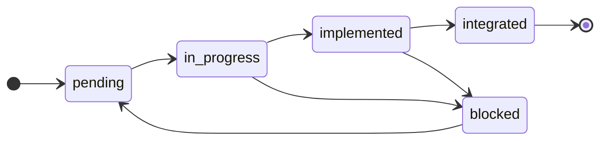

# Task File Specification

This document specifies the [task file](GLOSSARY.md#task-file): the one
[handoff](GLOSSARY.md#handoff) the factory keeps. The [planner](GLOSSARY.md#planner) writes it, an
[implementer](GLOSSARY.md#implementer) builds from it, and the [tester](GLOSSARY.md#tester) and the
[integrator](GLOSSARY.md#integrator) of the same task read it. Every task file of a project,
together, is the [plan](GLOSSARY.md#plan).

It also fixes the rules the planner writes the plan under, because those are what the
[human operator](GLOSSARY.md#human-operator) checks at the planner's gate 2, and the rules a reading
agent applies to a task file before it acts on one.

Vocabulary is fixed by [`GLOSSARY.md`](GLOSSARY.md); paths by
[`REPOSITORY_LAYOUT.md`](REPOSITORY_LAYOUT.md); the contracts a task depends on, the module map and
the commands by [`CONTRACT_SPEC.md`](CONTRACT_SPEC.md); what an agent records about a task by
[`REGISTRY_SPEC.md`](REGISTRY_SPEC.md); the planner's gates by
[`APPROVAL_PROTOCOL.md`](APPROVAL_PROTOCOL.md); branches, worktrees and merges by
[`GIT_CONVENTIONS.md`](GIT_CONVENTIONS.md).

Two properties hold, and most of what follows is a consequence of one of them:

- **The plan is a directory, and each task carries its own status.** There is no index. Tasks run in
  parallel, and a file that N agents update at once is a file with N writers.
- **What an Opus decides is written down.** A task file carries the implementation, the interfaces
  and the tests to write, complete enough that the implementer decides nothing. It does not
  re-derive the plan; it executes one task of it.

---

## 1. The plan

### 1.1 One file per task

```text
.factory/tasks/<feature>/<id>.md
```

The directory `.factory/tasks/` is the plan, and a file in it is a task of the plan. **Reading the
plan means listing the directory and reading the frontmatter of each file.** The
[dispatcher](GLOSSARY.md#factory-scripts) does exactly that, and so does an operator who wants to
know where the project stands.

**Task files are read and written in the main checkout, never in a worktree.** An implementer works
inside `../wt-<id>`, where a copy of `.factory/tasks/` also exists and goes stale the moment another
task changes status. The [launcher](GLOSSARY.md#factory-scripts) passes the path of the main
checkout to every session it starts, and every read or write of a task file goes there.

### 1.2 Why there is no index

Until `4.0.0` the plan was a `tasks.yaml` index plus one file per task, and the index held every
status. That worked while one task was alive at a time. With N tasks running, the index becomes the
one file every agent and every script writes, and the factory's third principle — one file, one
writer — has no way to hold for it.

Everything the index carried went somewhere with a single writer:

| The index carried | Now |
|---|---|
| each task's `status` | the task's own file (§5) |
| the order of execution | the dependencies of each task (§4); nothing else sequences the work |
| the features and their goals | the [vision](GLOSSARY.md#vision-visionmd) and the task files that name each feature |
| stack, paths, commands, `architecture` | the root `CLAUDE.md` ([`CONTRACT_SPEC.md`](CONTRACT_SPEC.md) §5) |
| `detailed`, per feature | nothing: a task file exists once its [wave](GLOSSARY.md#wave) has been planned, and not before |

### 1.3 Who writes a task file, and what they may change

**The planner writes every field of every task file**, at its gate 2. After that, exactly one line
of the file ever changes outside a replanning: `status`, and only for the transition the writer owns
(§5). Nothing else in a task file is edited by anybody — not a path in `files`, not a criterion,
not a line of the implementation. An agent that changes one has replanned the project on its own
authority.

The planner itself changes a written task file only while [replanning](GLOSSARY.md#replanning), and
only under §8.1.

---

## 2. The format

### 2.1 A task file

````markdown
---
id: T012
type: task
task_type: implementation
feature: player-control
module: mechanics
status: pending
priority: normal
wave: 1
depends_on_contract: [state/PlayerState, events/PlayerJumped]
depends_on_task: []
files:
  - src/mechanics/player/jump.ts
  - tests/mechanics/player/jump.test.ts
shared_file_notes: []
references:
  - .factory/project/reference/08-engineering/coding-standards.md
  - .factory/project/reference/03-characters/player/contract.md
factory_version: 4.3.0
created: 2026-09-21
---

# T012 — Apply an upward impulse on jump input

## Description
## Preconditions
## Constraints
## Interfaces
## Implementation
## Acceptance criteria
## Manual check
````

The frontmatter carries what is data, and is what scripts read. The body carries what is prose or
code, and is what agents read. §9 shows a file of this shape filled in.

### 2.2 Frontmatter

Every field below is required unless the table says otherwise, in this order. A field not listed
here does not exist, and a task file that carries one is malformed (§7).

| Field | Type | Allowed values |
|---|---|---|
| `id` | task id | `T` + three zero-padded digits for a task, `B` + three for a bug; unique in the plan, never reused. The file is named `<id>.md` |
| `type` | enum | `task`, `bug` |
| `task_type` | enum | `implementation`, `scaffolding` (§6.3) |
| `origin` | task id | **only on `type: bug`, and required there**: the task whose behaviour failed |
| `feature` | slug | kebab-case; the same string as the `<feature>/` directory the file sits in |
| `module` | module name | a module of the map in the root `CLAUDE.md`, or `tooling` (§3.3) |
| `status` | enum | `pending`, `in_progress`, `implemented`, `integrated`, `blocked` (§5). The planner always writes `pending` |
| `priority` | enum | `normal`, `high`. A bug is always `high`; the dispatcher starts `high` first |
| `wave` | integer ≥ 0 | the planning session that wrote the file; **informational only** (§4.3) |
| `depends_on_contract` | list of contract ids | paths under `contracts/` without extension; `[]` when there are none |
| `depends_on_task` | list of task ids | ids of other task files; `[]` when there are none |
| `files` | list of paths | repository-relative; production and test files together (§3) |
| `shared_file_notes` | list of notes | directed instructions for the integrator (§3.4); `[]` when there are none |
| `references` | list of paths | repository-relative paths of files under `.factory/project/reference/`, each one a piece `reference/README.md` marks approved: exactly what the task is built and tested against, and nothing it merely relates to (§2.10); `[]` only when no approved piece governs what the task produces |
| `factory_version` | semver | the value in `.factory/FACTORY_VERSION` when the file was written |
| `created` | date | `YYYY-MM-DD`, no time component |

**`[]` is written out on the four list fields that may be empty.** An absent list and an empty one
mean the same to a parser and different things to a reader: *this task needs nothing* against *the
planner did not ask*. Writing `[]` forces the question to be answered.

**The feature slug is the same string everywhere**: this field, the directory, the `feat/<feature>`
branch, and the registry paths of every agent that works on the task. One slug, no translation step.

**`created` and `factory_version` are the values of the moment the file was written**, and a rewrite
in replanning sets both again (§8.1).

### 2.3 Body

A task file opens with one heading, `# <id> — <title>`, and then its sections, in this order and
with these exact headings:

| Section | On `type: task` | On `type: bug` | Holds |
|---|---|---|---|
| `Description` | always | — | one paragraph: what is built and why — never a paraphrase of the code below |
| `Reproduction` | — | always | the steps that make the failure happen, as the manual test that found it recorded them |
| `Expected / Observed` | — | always | what should have happened, and what did |
| `Preconditions` | optional | — | what earlier tasks produced that this one builds on — claims about the plan, not about the disk |
| `Constraints` | optional | optional | boundaries on the solution: an API to use, a pattern to avoid, a budget to respect |
| `Interfaces` | always on `implementation` | always | the symbols the task declares and the ones its tests exercise (§2.4) |
| `Implementation` | always on `implementation` | always | the code (§2.5) |
| `Acceptance criteria` | always | always | at least one; on a bug, at least one reproduces the failure (§2.6) |
| `Manual check` | optional | optional | one line naming what only a person can judge (§2.7) |

**The title** is in the imperative, at most 72 characters, and has no `and` (§6.1). It lives in the
heading and nowhere else; the registry entries of the task copy it verbatim.

An optional section that does not apply is **left out**, not written empty. Absence is unambiguous
for these four, which is the difference from the frontmatter lists.

### 2.4 `Interfaces`

````markdown
## Interfaces

| File | Symbol | Role | Building block | Signature |
|---|---|---|---|---|
| `src/mechanics/player/jump.ts` | `jump` | exports | use case | `(state: PlayerState, input: JumpInput) => PlayerState` |
| `contracts/state/PlayerState.ts` | `PlayerState` | uses | — | `interface PlayerState` |
````

| Role | Means | Binding? |
|---|---|---|
| `exports` | a symbol this task declares or changes, and that another task may compile against | **yes** — §2.8 |
| `uses` | a symbol that already exists and that this task's tests exercise | no |

**`Building block` names what each `exports` row is in the project's design**, in the words of the
project's engineering references — for a domain-driven design, the building block (aggregate,
entity, value object, domain event, domain service, policy, factory, repository, use case, system).
It is `—` where none applies: a `uses` row, tooling, a widget, a type of a shared module that holds
no domain rule. The implementer builds the symbol as that block, and the tester holds it to that
block's rules. A symbol that is two blocks at once is two symbols.

**`Interfaces` is required on every `implementation` task**, because check 4 of `verify-task`
compares each test file against it (§5.2). Without it that check has nothing to compare against, and
the one protection the automated signal has against a vacuous test is gone.

**`uses` is what lets a task that exports nothing pass that check.** A task writing integration tests
declares no symbol; a bug that corrects an existing function declares none either. Both list what
their tests exercise, as `uses`, and check 4 accepts either role.

The `Signature` is written in the stack's notation, verbatim, because what depends on it is a
compiler. A private helper the task happens to need is `Implementation`, not an interface: listing it
would bind a detail nobody else can see.

### 2.5 `Implementation`

The code, written by the planner, in the language and style the stack fixes, as fenced blocks — one
per file, each opening with a comment naming the file and whether it is new, replaced whole or
edited.

**What goes in it:** the algorithm, the shape of every function, the values of every enumeration, the
default of every parameter, the exact strings, and — where an existing file is edited — what the
lines said before and what they say after. If the implementer has to decide something, that decision
was the planner's and it was skipped (§6.2).

**What does not:** the body of any test (§2.6); the reasoning behind the design, which goes to the
planner's registry; and any instruction addressed to the implementer as a reader rather than as an
executor. The field is code, not a briefing.

**It is authoritative, not binding.** The planner writes it against the tree as it stood when the
wave was planned, and it is the best-informed prediction in the factory — but a prediction. The
implementer may **adapt** it so that it compiles and passes, and records the adaptation as a
deviation in its registry. It may not **replace** it with a different design: that is replanning,
which is not the implementer's to declare.

On a `scaffolding` task it is absent only when the task writes no file whose contents are a decision.
Installing a dependency decides nothing; a linter configuration is a file whose every line is a
choice, and it belongs here in full.

### 2.6 `Acceptance criteria`

````markdown
## Acceptance criteria

| Test file | Test name | Assertion |
|---|---|---|
| `tests/mechanics/player/jump.test.ts` | applies the jump impulse to a grounded player | A grounded player with velocity.y = 0 has velocity.y = -420 after one jump. |
````

| Column | Fixes |
|---|---|
| `Test file` | where the test goes; it must be in `files` |
| `Test name` | the test's name, **verbatim as it will appear in the test file**, in the stack's convention — `verify-task` looks for it character for character (§5.2) |
| `Assertion` | what must be true, as something an automated test can assert |

**The planner names the test; the implementer writes its body**, against the `Assertion` and not
against the `Implementation`. A test written by the author of the code it judges exercises the path
that code happens to take; one written against an independently stated assertion can catch the code
being wrong.

**Every criterion is an automated assertion.** A criterion that needs a person to judge it is not a
criterion; it is a [manual check](GLOSSARY.md#manual-check).

**On a `scaffolding` task, `Test file` and `Test name` are `—`**, and the assertion names a command
and its expected outcome: *`npm run lint` exits 0 on the empty source tree*. There is no test to name,
which is exactly the exemption `scaffolding` declares.

**On a bug, at least one criterion reproduces the failure**: a test that would have failed against
the code the manual batch rejected.

**A criterion that comes from a reference names it.** Where a number, a duration, a pose, a colour
or an order of events is fixed by a piece in `references`, the `Assertion` states the value as the
reference gives it and ends with its source in parentheses — the path under `reference/` and the
section: *(`03-characters/akeris/contract.md` §Poses)*. A value the reference fixes is copied, never
rounded or reinvented; one it does not fix is the planner's decision, and carries no source.

### 2.7 `Manual check`

One line naming what only a person can judge about this task — how it feels, how it looks:

```markdown
## Manual check

The double jump fires on the same frame as the second key press, with no perceptible delay.
```

**Its absence is the normal case**, and means nothing about the task is observable that way. Where
it is present, the tester writes a [manual test](GLOSSARY.md#manual-test) from it, and the operator
runs it in the feature's [manual batch](GLOSSARY.md#manual-batch). The manual batch is the scarcest
resource in the factory, so a check that an automated test could make does not belong here.

**A bug almost always carries one.** It was found by a person looking, and a person looking is what
confirms it gone.

#### The manual test it produces

The tester writes it at `.factory/manual-tests/<feature>/<id>.md`, in the main checkout:

````markdown
---
task_id: T012
feature: player-control
factory_version: 4.3.0
created: 2026-09-21
---

# T012 — Apply an upward impulse on jump input

Run: `npm run dev`

## Step 1 — answers: Manual check

1. Stand the player on the ground and press jump twice, quickly.
2. The second jump starts on the frame of the second press, with no visible delay.

## Verdict

pending
````

| Part | Holds |
|---|---|
| frontmatter | the task's id and feature, the stamp and the date, like every factory artefact |
| heading | the task's heading, verbatim |
| `Run:` | `run_command` from the root `CLAUDE.md`, exactly as typed there |
| `## Step N — answers: <what>` | one step per thing a person must judge, each naming what it answers — `Manual check`, or the `Test name` of a criterion whose assertion only a person can see through. Numbered actions, then what must be observed |
| `## Verdict` | `pending`, as the tester writes it; the operator replaces it with `PASS`, or `FAIL — <what was seen>` |

Three rules keep the manual batch cheap, because the operator's time is the scarcest thing the factory
spends:

- **Every step names what it answers.** A step that answers nothing is deleted, not kept as general
  checking.
- **No step covers ground an automated test already covers.** The tester has just read the tests; what
  they assert is not repeated here for a person to watch.
- **Steps are only what a person needs.** No setup a script could do, no exploratory play.

**A later run never overwrites an earlier one.** The tester runs once per implementer attempt, and a
task rebuilt after a replanning runs it again: each later manual test goes beside the first as
`<id>-02.md`, and the operator runs the latest.

The verdict is the one line of a factory artefact written by a person, and it is what the planner reads
to write a bug task file (§8.2). The manual test is committed with the rest of the state of execution
([`GIT_CONVENTIONS.md`](GIT_CONVENTIONS.md) §2.2).

### 2.8 What is binding

| Field | Binding? | When reality disagrees |
|---|---|---|
| `Acceptance criteria` | **yes** | the task does not pass `verify-task` |
| `references` | **yes** — above the `Implementation` | where the code the task asks for contradicts a cited reference, the reference wins and the implementer records the deviation; where the reference is ambiguous, or contradicts an `exports` row or a criterion, it stops (§7.3) |
| `Interfaces`, `exports` rows | **yes**, their `Building block` included | the implementer stops and writes a blocked file (§7.3) |
| `files` | **a gradient** | §3.2 |
| `Implementation` | no — authoritative | the implementer adapts it and records the deviation |
| `Interfaces`, `uses` rows | no | they describe what already exists; a wrong one is a finding for the planner, not a stop |

**What makes a field binding is whether another task depends on it.** A signature another task
compiles against cannot move quietly: the task that breaks is one nobody is watching, possibly in
another feature. A function body that does not survive the compiler breaks nothing but itself.

### 2.9 Fields that deliberately do not exist

| Absent | Why |
|---|---|
| `title` in the frontmatter | the heading carries it; a second copy is a second place to disagree |
| `from`, `to`, `project` | a task file has one writer and one kind of reader, fixed by its path |
| `blocks` | the reverse of `depends_on_task`; two directions of one edge desynchronise |
| `must_not_touch` | retired in `4.0.0`; the file gradient and the module map do its work (§3) |
| `comprehension_check` | retired in `4.0.0`; it needed a pause with a person present, and an unattended session has none |
| `assignee`, `estimate` | every task is built by an implementer; nothing is timeboxed |
| `previous_status` | only the planner leaves `blocked`, and always to `pending` (§5) |
| `approved` | a task file exists only because the planner's gate 2 approved it |
| `notes`, dates other than `created` | free text goes to registries; git dates the work |

### 2.10 `references`

**A task file lists the references it is built against, and the agents that build it read those and
no others** ([`CONTEXT_POLICY.md`](CONTEXT_POLICY.md) §2.2). The list is the planner's decision, made
with the whole of `reference/` in front of it; the implementer and the tester never go looking.

- **Exact paths, never directories.** `03-characters/akeris/contract.md`, not `03-characters/akeris/`.
  A directory is a read nobody bounded.
- **Every task that writes code cites `08-engineering/coding-standards.md`**, and the other pieces of
  `08-engineering/` its work touches — `architecture.md` for a task that adds a feature, a layer or a
  contract, `design-patterns.md` for one that meets a problem that document lists, `testing.md` for
  every task that writes tests.
- **A task that draws, animates, sounds or lays out something cites that thing's contract**, and its
  `sheet.png` or `sandbox.html` where the contract points to them for what words cannot fix.
- **Only approved pieces.** A piece `reference/README.md` does not mark approved does not exist for
  the plan: a task that needs one waits for the operator, and the planner says so at gate 1.

---

## 3. Files

### 3.1 What `files` may name

`files` lists every file the task is expected to create or change, production and test alike.

- **Every path is inside a root of the task's own module**, as the module map declares it. What lies
  outside belongs to another module — and therefore to another task — or is a shared file.
- **Nothing under `contracts/`.** Contracts belong to the [architect](GLOSSARY.md#architect).
- **No [shared file](GLOSSARY.md#shared-file).** Its changes go in `shared_file_notes` (§3.4).
- **A stub the task replaces is named here**, which is how the task takes ownership of it.

The one exception is `module: tooling` (§3.3).

### 3.2 The file gradient

Resolved against the module map of the root `CLAUDE.md`
([`CONTRACT_SPEC.md`](CONTRACT_SPEC.md) §5.1):

| The file is… | The implementer… |
|---|---|
| in the task's `files` | proceeds |
| not listed, but **inside a root of its own module** | proceeds, and records the deviation in its registry |
| **outside its module**, a shared file, or under `contracts/` | **stops**, writes a blocked file and ends the session (§7.3) |

The gradient replaces the rigid rule of earlier versions, under which any unpredicted file stopped
the session and cost a replanning over imperfect foresight. It keeps the one boundary parallel work
needs: nobody writes outside their own module. Check 5 of `verify-task` enforces the same line after
the fact (§5.2).

**The gradient can break file disjointness, and that is accepted.** A file of its own module that a
task did not list may be in the `files` of another task running at the same time. Nothing prevents
it in advance. The merge or the suite catches it at [integration](GLOSSARY.md#integration), which
writes a blocked file with `needs: planner`, and the cost is one task redone. Restricting the
gradient to new files only was considered and rejected: it brings back the friction the gradient was
introduced to remove.

### 3.3 `tooling`

`module: tooling` is reserved for wave 0, and is valid only with `task_type: scaffolding`. It is not
in the module map and has no roots: the package manifest, the language configuration, the linter,
the test runner and the build configuration live at the repository root, inside no module.

**A `tooling` task touches exactly its `files`, and nothing else.** With no roots, the gradient gives
it no margin, and any unlisted file is a stop.

**After wave 0, those root files are shared files.** A later task that needs a new dependency does
not list the manifest in `files`; it asks for the change in `shared_file_notes`, and the integrator
applies it.

### 3.4 `shared_file_notes`

A system index, a configuration table, the package manifest: files several tasks need an entry in.
**Only the integrator edits them, and the implementer never opens one.** A task that needs an entry
declares it as a directed instruction, not as prose, so the integrator can apply the notes one by
one:

```yaml
shared_file_notes:
  - file: src/game/systems.ts
    instruction: Register `jumpSystem` from `src/mechanics/player/jump` after `movementSystem`.
```

| Key | Holds |
|---|---|
| `file` | the shared file, repository-relative |
| `instruction` | one change, stated so that applying it decides nothing |

An implementer that discovers a shared file needs a change the notes do not carry stops, with
`needs: planner`: the plan missed it.

---

## 4. Dependencies

### 4.1 The two kinds

This distinction is what makes the plan wide instead of nearly linear.

| Field | Blocks the task? | Used when |
|---|---|---|
| `depends_on_contract` | **no** — the contract and its stub exist from the first day | the task consumes a contract |
| `depends_on_task` | **yes** | the task needs the **real behaviour** of another task, not only its declaration |

`depends_on_contract` exists for impact analysis: when a contract changes, it answers which tasks
were written against it. A task that imports a contract and does not declare it has hidden itself
from the one question that matters most when the contract moves.

**`depends_on_task` is satisfied by `integrated`, never by `implemented`.** An `implemented` task has
passed its own checks and may still fail to merge or break the suite; a task started against it would
be built on code that may never land.

### 4.2 What the dispatcher does with them

A task is ready when its `status` is `pending` and every id in its `depends_on_task` is `integrated`.
`high` priority goes first. That is the whole of scheduling: the dispatcher does not validate the
plan, does not look at `wave`, and does not compare `files` between tasks.

A task whose dependency is `blocked` is simply never ready, and neither is anything that depends on
it. The rest of the plan keeps running.

**A cycle in `depends_on_task` is never dispatched**, and nothing reports it. The planner writes the
plan so that none exists, and the operator reads for one at gate 2.

### 4.3 `wave` does not restrict dispatch

`wave` records which planning session wrote the file, and nothing else. If a task of wave 3 has every
dependency satisfied, it starts even though tasks of wave 2 have not. The dependencies already order
the work, and the field is informational on purpose — stating it keeps anyone from implementing it
as a constraint.

---

## 5. Status

### 5.1 The lifecycle



| Transition | Written by | When |
|---|---|---|
| `pending → in_progress` | the launcher | when it opens the worktree |
| `in_progress → implemented` | `verify-task` | when every check in §5.2 passes |
| `implemented → integrated` | `integrate.py` | after the integrator's session, on finding its merge commit on the feature branch, holding every file of its `shared_file_notes`, with nothing left uncommitted in the integration worktree |
| `* → blocked` | the implementer or the integrator; the launcher | when it stops; when escalation runs out, or an integration ends with no merge and no blocked file |
| `blocked → pending` | the planner | when it replans the task (§8.1) |

**A success status is written by a script, never by an agent**, because it means *the verification
passed*, and only the script knows that. For `integrated` the verification is the integrator's own —
the merge and the whole suite — and what the script checks is its result: a merge commit carrying
`Task: <id>` on `feat/<feature>` that changes every file of the task's `shared_file_notes`, and an
integration worktree with nothing left uncommitted. An integrator that stops writes `blocked` and
never commits the merge ([`GIT_CONVENTIONS.md`](GIT_CONVENTIONS.md) §3.3), so that commit exists only
when both passed. An agent writes `blocked` and nothing else, with one
declared exception: **the planner returns a blocked task to `pending`**, because replanning is its
job. It is the only way out of `blocked`, whatever the blocked file's `needs` said: when the
architect fixes a contract, the planner still runs afterwards and makes that transition.

Each of these writes changes the `status` line of one file and nothing else. **Status lives in the
task file and nowhere else** — no registry entry, blocked file or manual test records it.

### 5.2 What `verify-task` requires

`verify-task` runs in the task's worktree when the implementer has finished. It spends no tokens and
asks nobody. The task does not become `implemented` if any check fails.

| # | Check | Reads | On `scaffolding` |
|---|---|---|---|
| 1 | `test_command` exits 0 | root `CLAUDE.md` | runs |
| 2 | Every `Test file` named in `Acceptance criteria` exists | the criteria | **skipped** |
| 3 | Every `Test name` appears, verbatim, in its `Test file` | the criteria | **skipped** |
| 4 | Every `Test file` references at least one `Symbol` in `Interfaces` | the criteria, `Interfaces` | **skipped** |
| 5 | The diff touches nothing outside `files` plus the roots of the task's module | `files`, `module`, the module map | runs |
| 6 | `lint_command` exits 0 | root `CLAUDE.md` | runs |

**Checks 2, 3 and 4 are skipped on `scaffolding`**, which is what makes wave 0 executable: a task
that installs a package manifest has no tests to name. On a `tooling` task, check 5 compares against
`files` alone.

**Check 4 is what replaced red-before-green.** A test that references nothing the task declared —
`expect(true).toBe(true)` — does not pass it. It does not catch a test that references the right
symbols and asserts something irrelevant; only a task file that says precisely what to test does.

This is why `Test name` must be verbatim and `Interfaces` must be a table: two of the checks are
string searches, and a script cannot translate prose.

---

## 6. Writing the plan

These rules bind the planner. It checks them while writing, and the operator checks them at the
planner's gate 2 — the last point before a mistake is multiplied by every task that runs at the same
time. None of them is checked by a script.

### 6.1 One task, one thing

**The title is in the imperative, at most 72 characters, and has no `and`.** If the sentence
describing a task needs a conjunction to be accurate, it is two tasks. The test is not whether the
word appears but whether removing it loses work the task actually does: *Configure the linter and
the formatter* is two tasks; *Clamp paddle movement to the play field* is one.

The rule decomposes by meaning rather than size. Two hundred lines that do one thing are one task;
thirty lines that do two are two. The 72 characters are the git subject budget, imposed here so that
no title is written which the integrator cannot later use as a commit subject.

### 6.2 Completeness

**A task is complete when the implementer can build it without deciding anything.** The check is one
question, asked of every task file just written:

> Reading only this task file, the references it cites, the contracts and the `CLAUDE.md` files,
> would two competent implementers produce the same files?

Where the answer is no, the difference between them is the decision that was skipped. It is usually
one of four:

| Left open | Where it belongs |
|---|---|
| the name of something another task refers to | `Interfaces`, as `exports` |
| what an existing file currently contains | `Preconditions` |
| which of two shapes the code takes | `Implementation` — pick one |
| whether a neighbouring file may change | `files`, or the module map |
| what the thing looks, sounds or moves like | `references`, and the criteria that cite them |

Completeness is not length. A scaffolding task installing one dependency is complete in three lines.
A task is incomplete when something is missing, never when something is short.

### 6.3 Tests, and `scaffolding`

**Every `implementation` task has at least one acceptance criterion with a test file.**
**`scaffolding` is a declaration, not an escape hatch**: it exempts a task from naming tests because
the task produces structure, not behaviour — tooling, configuration, a build. A task marked
`scaffolding` that produces behaviour is mis-marked.

A quality that no test can assert — *the jump feels responsive* — is decomposed into what can be
asserted (the velocity after one input frame, the coyote-time window in milliseconds) plus a
`Manual check` for the feel. A task whose only evidence would be a person playing the game is not a
task yet.

### 6.4 Waves

- **Wave 0 is always tooling.** The package manifest, the language configuration, the linter, the
  formatter, the test runner and the build, as `scaffolding` tasks in `module: tooling`. The
  architect wrote the contracts and stubs as text; wave 0 is what makes them compile and run green.
- **The first planning session writes wave 0 and wave 1.** Every later session writes one wave.
- **Shared modules come first.** Wave 1 builds the shared modules the next waves import, in features
  of their own, which reach `main` before any feature that imports them is cut
  ([`CONTRACT_SPEC.md`](CONTRACT_SPEC.md) §4.1). A task that imports a shared module states, in
  `Preconditions`, the symbols it needs and that they are on `main`.
- **A wave is written against the tree as it stands.** The planner reads the code on `feat/`
  branches and the implementers' registries — every adaptation they made to the implementations
  they were given — before it writes the next wave's. An implementation written weeks ahead of the
  code it edits is a sketch, and the likeliest kind.
- **A wave may cross features**, and usually does: that is where the parallel width comes from.

### 6.5 Tasks that can run together never share a file

**No file appears in the `files` of two tasks that could be alive at the same time** — two tasks
where neither depends, directly or through others, on the other through `depends_on_task`. The whole
branch model rests on this: task branches fall behind their feature branch as others integrate and
are never rebased, which works only because no two of them touched the same file.

Nothing automatic checks it. The dispatcher does not compare `files`, deliberately: a plan that asks
two tasks to change one file is a defect to see and fix in the plan, not a condition for a script to
route around in silence. **This is the check the operator most needs to make at gate 2.**

### 6.6 Integration tests are tasks

**Each feature has at least one task whose tests exercise more than one module together.** It is an
ordinary `implementation` task in the module the architect declared for integration tests, it lists
what its tests exercise in `Interfaces` as `uses`, and it `depends_on_task` on every task whose joint
behaviour it verifies. The integrator runs no special suite: `test_command` already includes these
tests once they exist.

---

## 7. Reading a task file

### 7.1 `factory_version`

**Every agent compares a task file's `factory_version` against `.factory/FACTORY_VERSION` before it
acts on the file**, and the task file is the one [artefact](GLOSSARY.md#artefact) this check applies
to, because it is the one an agent acts on. The stamps on the vision, blocked files, registry entries
and manual tests are there for a person to detect an artefact from another contract, and nothing
acts on them.

| Difference | Means | The agent |
|---|---|---|
| identical | the same factory contract | proceeds |
| PATCH differs | wording only | proceeds |
| MINOR differs | a backwards-compatible addition | proceeds; a field this document does not define is not an error when the file is the newer of the two |
| MAJOR differs | the factory contract itself changed | treats the file as **malformed** (§7.2) |

A game bootstrapped under `3.x` does not migrate to `4.x` ([`REPOSITORY_LAYOUT.md`](REPOSITORY_LAYOUT.md)
§4), so within one game this row fires only if an operator adopts a new major version in the middle
of a project.

### 7.2 A malformed task file

An agent that is about to act on a task file stops, with `needs: planner`, when the file:

- has frontmatter that does not parse, or a required field that is missing or empty;
- carries a field §2.2 does not define — subject to the MINOR row of §7.1;
- has an `id` that is not `T` or `B` plus three digits, or that differs from its file name, or a
  `feature` that differs from its directory;
- carries a value outside the allowed set for `type`, `task_type`, `status` or `priority`;
- has `origin` on a `type: task`, or lacks it on a `type: bug`;
- names a `module` absent from the map, or `tooling` on anything but `scaffolding`;
- names a contract in `depends_on_contract` with no file under `contracts/`, or a task in
  `depends_on_task` with no task file;
- lists in `files` a path outside the task's module roots, under `contracts/`, or a shared file —
  `tooling` excepted;
- lists in `references` a directory, a path outside `.factory/project/reference/`, a file that does
  not exist, or a piece `reference/README.md` does not mark approved;
- lacks a body section §2.3 requires, or names a `Test file` on a `scaffolding` task;
- differs by a MAJOR `factory_version` (§7.1).

**Only the task file in front of the agent is checked.** Validating the whole plan at every session
start would mean reading every task of the game to build one, and a broken file elsewhere is found by
the session that reaches it.

**A malformed task file is never repaired by the agent that finds it.** It does not infer a missing
field, treat an absent one as a default, or proceed on what the planner obviously meant. Repairing a
task file is replanning, and replanning is the planner's.

### 7.3 Stops that arise during the work

§7.2 is a property of the file and is settled before any code is written. These are disagreements
between the task file and the repository, and a disagreement has to be met to be seen:

| Condition | `needs` |
|---|---|
| A `Precondition` is false: the plan and the tree have diverged | `planner` |
| An `exports` row of `Interfaces` cannot be honoured as written | `planner` |
| The task file contradicts a contract | `planner` |
| A cited reference is ambiguous on something the task must decide, or contradicts an `exports` row or a criterion | `planner` |
| Something is left for the implementer to decide (§6.2) | `planner` |
| A shared file needs a change `shared_file_notes` does not carry | `planner` |
| [Escalation](GLOSSARY.md#escalation) to Opus 5.5 did not resolve the task either | `planner` |
| The merge or the suite fails at integration | `planner` |
| A contract falls short, or a signature under `contracts/` would have to change | `architect` |
| The work would write outside the task's module (§3.2) | `architect` |

Every row ends the same way: the agent writes a [blocked file](GLOSSARY.md#blocked-file), sets the
task `blocked`, and ends its session. It writes no registry entry and integrates nothing. It leaves
its worktree and its `task/` branch as they are: nobody else works there, and they are the only
evidence of what was tried.

**Why these stop when an unlisted file of the own module does not.** Each is a statement the task
file made about something *outside the task* — an earlier task's output, a later task's dependency,
another module, a decision that should already have been taken. A wrong prediction inside the task
costs the task; a wrong statement about what surrounds it costs whatever was built on top of it before
anybody noticed.

---

## 8. Replanning and bugs

### 8.1 Replanning

Only the operator decides that replanning happens, by summoning the planner after a blocked file
with `needs: planner`, after the architect has changed a contract, or after a failed manual batch.
The planner revises **only the part of the plan the finding affects**, in an ordinary session under
its two gates, and records the event in a `replan-NN` session of its registry.

- **A wrong task file is rewritten in place.** The same id, the same path; `created` and
  `factory_version` set to the values of the day; `status` back to `pending`. The id is what ties the
  task to its `task/<id>` branch, whose half-done work the planner decides to reuse or discard, and to
  its blocked file, which keeps in `Asked to` what was asked the first time.
- **An `integrated` task file is never rewritten.** Its code is already in the feature, and a file
  that no longer described it would make the record disagree with the work. What has to change is a
  new task, or a bug.
- **A `pending` task that is no longer needed is dropped by deleting its task file.** A file in
  `tasks/` *is* a task of the plan, so keeping it would keep the task. Git keeps the file; the
  planner's registry entry says what was dropped and why.
- **No id is ever reused**, not even a dropped one. New tasks take the next free id of their letter.
- **Blocked files, registry entries and manual tests are never touched by replanning.** The plan is
  revised; the record stands.

### 8.2 A bug task file

A failure found in the manual batch **never reopens the task it came from**, which is already merged.
The planner writes a bug task file in a replanning session: `type: bug`, a `B` id, `origin` naming
the failed task, `priority: high`, and the body of §2.3.

Before writing it, the planner classifies the failure, because the class decides who fixes it:

| Class | Question | Resolved by |
|---|---|---|
| Implementation | Does the code break a contract, or its task file? | a bug task, like any other |
| Integration | Does each part work alone and fail together? | usually a gap in a contract: the architect first, then a bug task |
| Contract or design | Does the code honour the contract, and the game still fail? | the architect, under its two gates, then a bug task |

Two more obligations:

- **Pending tasks that depend on the failed behaviour gain the bug's id in `depends_on_task`**, so
  that nothing more is built on it until it is fixed.
- **The feature's pull request is not opened** until its manual batch passes.

---

## 9. Worked example

The task a wave-1 implementer receives for the platformer of
[`CONTRACT_SPEC.md`](CONTRACT_SPEC.md) §7. It replaces the stub `src/mechanics/player/jump.ts`.

`.factory/tasks/player-control/T012.md`

````markdown
---
id: T012
type: task
task_type: implementation
feature: player-control
module: mechanics
status: pending
priority: normal
wave: 1
depends_on_contract: [state/PlayerState, events/PlayerJumped, ports/System]
depends_on_task: []
files:
  - src/mechanics/player/jump.ts
  - tests/mechanics/player/jump.test.ts
shared_file_notes:
  - file: src/game/systems.ts
    instruction: Register `jumpSystem` from `src/mechanics/player/jump` after `movementSystem`.
references:
  - .factory/project/reference/08-engineering/coding-standards.md
  - .factory/project/reference/03-characters/player/mechanics.md
factory_version: 4.3.0
created: 2026-09-21
---

# T012 — Apply an upward impulse on jump input

## Description

Give a grounded player an upward velocity when the jump input arrives, and emit the event every
other module reacts to, so that a jump is one fact the whole game agrees on.

## Constraints

- The impulse is the exported constant `JUMP_IMPULSE`, never a literal inside the function.
- The time of the jump arrives as `now`; game logic never reads the clock.

## Interfaces

| File | Symbol | Role | Signature |
|---|---|---|---|
| `src/mechanics/player/jump.ts` | `jump` | exports | `(state: PlayerState, pressed: boolean, now: number) => [PlayerState, PlayerJumped \| null]` |
| `src/mechanics/player/jump.ts` | `JUMP_IMPULSE` | exports | `number` |
| `src/mechanics/player/jump.ts` | `jumpSystem` | exports | `System` |

## Implementation

```ts
// src/mechanics/player/jump.ts — replaces the stub, whole contents.
import { PlayerState } from "../../../contracts/state/PlayerState";
import { PlayerJumped } from "../../../contracts/events/PlayerJumped";
import { System } from "../../../contracts/ports/System";

export const JUMP_IMPULSE = -420;

export function jump(
  state: PlayerState,
  pressed: boolean,
  now: number,
): [PlayerState, PlayerJumped | null] {
  if (!pressed || !state.onGround) {
    return [state, null];
  }
  const next = { ...state, velocity: { ...state.velocity, y: JUMP_IMPULSE }, onGround: false };
  return [next, { at: now, from: state.position }];
}

export const jumpSystem: System = (world) => { /* … */ };
```

## Acceptance criteria

| Test file | Test name | Assertion |
|---|---|---|
| `tests/mechanics/player/jump.test.ts` | applies the jump impulse to a grounded player | A grounded player with velocity.y = 0 has velocity.y = -420 after `jump(state, true, 0)` (`03-characters/player/mechanics.md` §Jump). |
| `tests/mechanics/player/jump.test.ts` | ignores the jump input in the air | A player with onGround = false is returned unchanged, with no event. |

## Manual check

The jump starts on the same frame as the key press, with no perceptible delay.
````

Six things here are the format doing its job:

- **`depends_on_task` is empty.** The task consumes three contracts and needs nobody's behaviour, so it
  runs in wave 1 beside every other task of the wave. `visuals`, which reads `PlayerState`, does not
  wait for it either.
- **The system index is a shared file.** The task does not list `src/game/systems.ts`; it asks the
  integrator to register the system, which is how two tasks in two modules add systems at once
  without ever touching the same file.
- **The stub's signature survives.** The architect wrote `jump` with exactly this signature; the task
  replaces its body, and every module compiled against the stub compiles against the real thing.
- **Check 4 finds `jump` in the test file, and check 3 finds each test name verbatim.**
- **The `Manual check` is one line.** The tester turns it into a manual test with a `Run:` line and
  steps; the task file only says what a person has to judge.
- **There is a `status` line, and after this moment only the launcher, `verify-task`, the integrator
  or a blocked agent will ever change it** — each for its own transition, and none of them anything
  else in the file.

A bug found against it in the manual batch would arrive as `.factory/tasks/player-control/B001.md`,
with `origin: T012`, `priority: high`, a `Reproduction` section, and a criterion reproducing the
failure. `T012.md` would not change.
