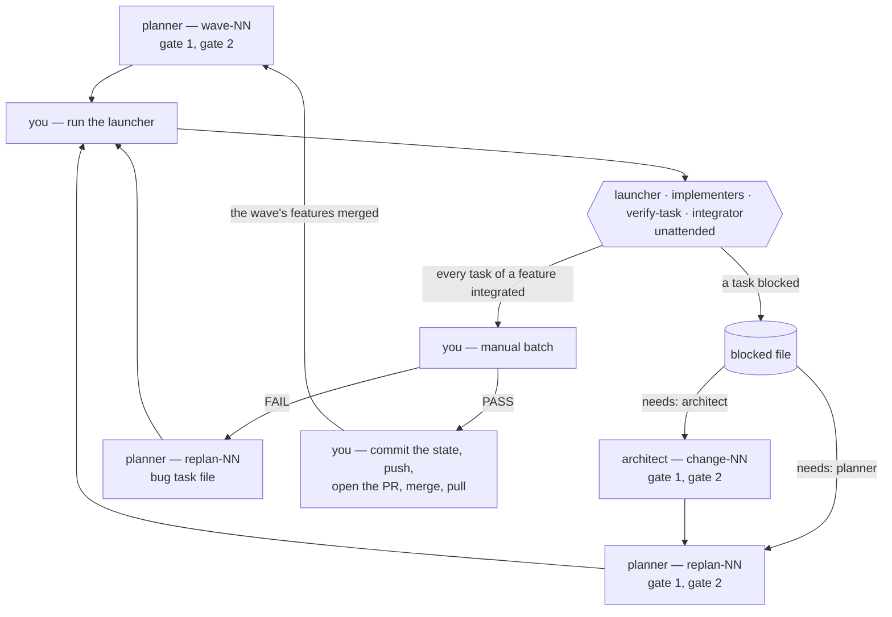

# End-to-End Operator Workflow

This document is the factory in motion. Every other document describes a part; this one follows a
[wave](GLOSSARY.md#wave) from its task files to two merged pull requests, with the artefacts each step
actually produces and the commands the operator types between them.

It is written for the [human operator](GLOSSARY.md#human-operator) of a project that has finished its
day one. [`BOOTSTRAP.md`](BOOTSTRAP.md) covers everything before this point — installing the factory,
the [translator](GLOSSARY.md#translator), the [architect](GLOSSARY.md#architect), the first
[planner](GLOSSARY.md#planner) session, and the `tooling` feature merged into `main`. The loop below
starts where that document ends.

**Where this document contradicts another, the other document wins.** It defines nothing: every
rule it shows is fixed elsewhere, and a disagreement is a defect in this file or in the pair it sits
between, and is worth reporting either way.

| This document covers | Fixed by |
|---|---|
| what runs by itself, what waits for the operator, and the commands between | — |
| one wave walked end to end, with real artefacts: an escalation, a block, a replanning, a bug | — |
| what a [gate](GLOSSARY.md#approval-gate) is and what `APPROVED` means | [`APPROVAL_PROTOCOL.md`](APPROVAL_PROTOCOL.md) |
| what each agent does inside its session | that agent's harness, under `.factory/harnesses/` |
| the task file, its status, and what `verify-task` checks | [`TASK_FILE_SPEC.md`](TASK_FILE_SPEC.md) |
| branches, worktrees, commits, the lock and pull requests | [`GIT_CONVENTIONS.md`](GIT_CONVENTIONS.md) |
| registry entries and the pull request body | [`REGISTRY_SPEC.md`](REGISTRY_SPEC.md) |
| what the operator types to open a gated session | [`BOOTSTRAP.md`](BOOTSTRAP.md) §3.1–§3.4 |

---

## 1. The operator's loop

### 1.1 What runs by itself, and what waits for you

Three agents have gates and run only in front of you: the translator, the architect and the planner,
each an Opus 5.5 session you open. The other three — the [implementer](GLOSSARY.md#implementer), its
[tester](GLOSSARY.md#tester) and the [integrator](GLOSSARY.md#integrator) — run unattended, started
by the [factory scripts](GLOSSARY.md#factory-scripts), and never ask you anything.

| Runs by itself, once launched | Waits for you |
|---|---|
| choosing the next task, whenever its dependencies are `integrated` | running the launcher |
| cutting branches and worktrees, installing dependencies in each | the planner's gates, every wave and every replanning |
| building each task, on Sonnet 5, and retrying it on Opus 5.5 | reading a blocked file and summoning whom its `needs` names |
| checking it with `verify-task` | the architect's gates, when a contract has to change |
| merging it into its feature, running the whole suite | the [manual batch](GLOSSARY.md#manual-batch) |
| writing the feature's pull request body when its last task integrates | committing the state of execution, pushing, the pull request, the merge |

**Nothing on the left stops for you, and nothing on the right happens without you.** A blocked task
does not stop the wave — every task that does not depend on it keeps running — but it stays blocked
until you act, and so does everything that depends on it.

### 1.2 The loop

| # | Step | Who | Notes |
|---|---|---|---|
| 1 | plan the next wave | planner, `wave-NN` | two gates; commits `docs: plan wave <N>` on `main`. **At gate 2, check that no two tasks able to run together share a file** — [`TASK_FILE_SPEC.md`](TASK_FILE_SPEC.md) §6.5 |
| 2 | push, run the launcher | **you** | it keeps up to three implementers running until nothing is left to start, then prints a summary |
| 3 | act on each blocked task | **you**, then the planner or the architect | as the blocked file's `needs` says; then run the launcher again |
| 4 | run the manual batch of each finished feature | **you** | one verdict per [manual test](GLOSSARY.md#manual-test) |
| 5 | commit the state of execution | **you** | after each manual batch, and before each pull request |
| 6 | on a `FAIL`, have the bug planned | planner, `replan-NN` | a bug task file, `priority: high`; then back to step 2 |
| 7 | open the feature's pull request, merge it, pull | **you** | once every task is `integrated` and its manual batch passed |

Steps 2 to 7 repeat per feature, and features are independent: one can reach its pull request while
another is still being built. When a wave's features are merged, step 1 plans the next one against the
code as it now stands.

### 1.3 The loop as a diagram



### 1.4 What you type

The scripts, from the main checkout, on `main`:

| To | bash | PowerShell |
|---|---|---|
| run every ready task until nothing is left | `python3 .factory/scripts/launch.py` | `python .factory/scripts/launch.py` |
| the same, with N implementers at once instead of three | `python3 .factory/scripts/launch.py --max N` | `python .factory/scripts/launch.py --max N` |
| see what could start now | `python3 .factory/scripts/dispatch.py` | `python .factory/scripts/dispatch.py` |
| see the whole plan, by status | `python3 .factory/scripts/dispatch.py --status` | `python .factory/scripts/dispatch.py --status` |
| integrate an `implemented` task by hand | `python3 .factory/scripts/integrate.py T012` | `python .factory/scripts/integrate.py T012` |
| write a feature's pull request body again | `python3 .factory/scripts/integrate.py --feature player-control` | `python .factory/scripts/integrate.py --feature player-control` |

The last two are for when the launcher's summary tells you to; neither is part of the ordinary loop.

Git, identical in both shells:

| When | Command |
|---|---|
| after a gated session committed | `git push` |
| after each manual batch, and before each pull request | `git add .factory && git commit -m "chore: record the factory state"` |
| before opening a feature's pull request | `git push`, then `git push -u origin feat/<feature>` |
| after the pull request is merged | `git pull --ff-only`, then `git worktree remove ../wt-feat-<feature>` and `git branch -d feat/<feature>` |
| when the planner discarded a blocked task's work | `git worktree remove --force ../wt-<id>` and `git branch -D task/<id>` |

### 1.5 Five things that hold throughout

- **Approval is the literal keyword `APPROVED`**, typed in answer to the report that asked for it.
  `ok`, `dale`, 👍 and silence are feedback ([`APPROVAL_PROTOCOL.md`](APPROVAL_PROTOCOL.md) §2.1).
- **`.factory/` lives on `main`, in the main checkout.** Every task file, registry entry, blocked file
  and manual test is read and written there, and committed there. The copy of `.factory/` inside a
  worktree is stale by design and nobody touches it ([`GIT_CONVENTIONS.md`](GIT_CONVENTIONS.md) §2.1).
- **One launcher at a time.** A second one refuses to start. Run it again only once the first has
  printed its summary.
- **Nothing is retried inside one run.** A task that blocked, or that could not start, stays as it
  is until you act on it and run the launcher again.
- **Pushing, the pull request and the merge into `main` are yours.** No agent reaches the network for
  git, and no script does either ([`GIT_CONVENTIONS.md`](GIT_CONVENTIONS.md) §6).

---

## 2. The worked example

The small platformer of [`CONTRACT_SPEC.md`](CONTRACT_SPEC.md) §7, whose task `T012` is the worked
example of [`TASK_FILE_SPEC.md`](TASK_FILE_SPEC.md) §9. Wave 1 crosses two
[features](GLOSSARY.md#feature): **`player-control`**, followed end to end, and **`hud`**, which runs
beside it and is summarised in §2.11.

Inside `player-control`, three things go wrong, each in the way the factory expects things to go
wrong: a task needs Opus 5.5 to finish, a task conflicts when it integrates and is replanned, and the
manual batch rejects a jump and produces a bug. Two launches, two replanning sessions, two manual
batches, two pull requests.

Every artefact below is shown in the shape its harness actually produces. They are **abbreviated,
never invented**: an elision is marked `…`, and everything else is what would be on disk.

### 2.0 Where the project stands

Day one is done ([`BOOTSTRAP.md`](BOOTSTRAP.md) §4): the vision, the contracts and their stubs, and
the root and module `CLAUDE.md` files are on `main`, and so is `tooling`, merged by pull request. The
suite runs green over stubs that do nothing. The architect's module map has four modules —
`mechanics`, `input`, `visuals` and `integration`, the last one holding only tests — and the system
index, `src/game/systems.ts`, is under no root: a [shared file](GLOSSARY.md#shared-file) only the
integrator edits.

The planner's first session wrote wave 1 beside wave 0, so it is already on `main`, and the local
`main` has been pulled since `tooling` merged.

### 2.1 Wave 1, as planned

| id | feature | module | `depends_on_task` | title |
|---|---|---|---|---|
| `T007` | `hud` | `visuals` | `[]` | Draw the HUD layer over the play field |
| `T008` | `hud` | `visuals` | `[T007]` | Show the player's height on the HUD |
| `T009` | `hud` | `visuals` | `[T007]` | Show the jump count on the HUD |
| `T010` | `player-control` | `mechanics` | `[]` | Add the grounded check for bodies |
| `T011` | `player-control` | `input` | `[]` | Read the jump key from the keyboard |
| `T012` | `player-control` | `mechanics` | `[]` | Apply an upward impulse on jump input |
| `T013` | `player-control` | `integration` | `[T010, T011, T012]` | Test a key press turning into a jump |

`T012` is exactly the task file of [`TASK_FILE_SPEC.md`](TASK_FILE_SPEC.md) §9: it replaces the stub
`src/mechanics/player/jump.ts`, lists that file and its test, asks the integrator to register
`jumpSystem` in the system index, and carries a `Manual check`. `T010` replaces the other stub of
`mechanics`, `src/mechanics/player/state.ts`, and lists it. The two share no file, which is what the
planner's gate 2 checked. `T013` is the feature's integration test, required of every feature
([`TASK_FILE_SPEC.md`](TASK_FILE_SPEC.md) §6.6), and waits for the three tasks it exercises.

**Four tasks are ready**, one of them in `hud`:

```text
$ python3 .factory/scripts/dispatch.py
T007  hud                   Draw the HUD layer over the play field
T010  player-control        Add the grounded check for bodies
T011  player-control        Read the jump key from the keyboard
T012  player-control        Apply an upward impulse on jump input
```

### 2.2 The launch

Four tasks are ready and nothing links them, so the operator lets four run at once:

```bash
python3 .factory/scripts/launch.py --max 4
```

```text
launch: starting T007 — Draw the HUD layer over the play field
launch: starting T010 — Add the grounded check for bodies
launch: starting T011 — Read the jump key from the keyboard
launch: starting T012 — Apply an upward impulse on jump input
launch: T007 integrated
launch: starting T008 — Show the player's height on the HUD
launch: T012 integrated
launch: starting T009 — Show the jump count on the HUD
launch: T008 integrated
launch: T010 blocked by the integrator
launch: T009 integrated
launch: T011 integrated

launch: nothing left to start.
  T007  integrated
  T008  integrated
  T009  integrated
  T010  blocked by the integrator
  T011  integrated
  T012  integrated
```

It ran for most of an afternoon, and nobody was asked anything. Read in order, it says: `T007`
integrated and freed its two dependants, which started in the slots that came free; `T012`
integrated before `T010`, which then failed to integrate; `T011` took longest. `T013` never started,
because `T010` is not `integrated`. The next three sections are what happened inside.

### 2.3 Inside one task — `T012`

**The launcher prepares it.** `T010` started a moment earlier and was the first task of
`player-control`, so the feature branch and its integration worktree already exist. For `T012` the
launcher cuts the task alone, and installs its dependencies:

```bash
git worktree add ../wt-feat-player-control -b feat/player-control main   # done for T010, then npm ci
git worktree add ../wt-T012 -b task/T012 feat/player-control             # then npm ci in it
```

Then it changes one line of `.factory/tasks/player-control/T012.md`, in the main checkout —
`status: pending` becomes `status: in_progress` — and starts an implementer on Sonnet 5 in
`../wt-T012`, with the tester defined as its subagent. Its output goes to `../logs/T012-attempt-1.log`.

**The implementer builds it.** It reads the task file in the main checkout, puts in the
`Implementation`, and writes the two tests against their `Assertion`, under their exact names. Its
tests need a grounded player, and the stub's `createPlayerState` in `src/mechanics/player/state.ts`
can only build one that is in the air. It changes that function to take the flag. `state.ts` is not
in `T012`'s `files`, but it is inside a root of `mechanics`, so the file gradient lets it proceed and
note the deviation ([`TASK_FILE_SPEC.md`](TASK_FILE_SPEC.md) §3.2). **Remember this file.**

With the suite and the linter green, it starts the tester, which reads the tests against the
criteria, reports what they do not reach, and — because `T012` has a `Manual check` — writes the
manual test the operator will run. Then the implementer runs `verify-task`:

```text
verify-task T012
  check 1  pass  test_command exited 0
  check 2  pass  1 test file(s)
  check 3  pass  every name found
  check 4  pass  every test file references the task's interfaces
  check 5  pass  every changed file is inside the task's bounds
  check 6  pass  lint_command exited 0
T012 is now implemented. Commit the task, write your registry entry, and end.
```

Check 5 passes with `state.ts` in the diff because the check allows the task's module roots, not only
its `files` — the same line the gradient draws. `verify-task` has set `status: implemented`. The
implementer commits everything in its worktree as one commit, `T012: Apply an upward impulse on jump
input`, with no body and no footer ([`GIT_CONVENTIONS.md`](GIT_CONVENTIONS.md) §3.1), and writes its
registry entry in the main checkout.

`.factory/registry/implementer/player-control/T012.md`:

```markdown
---
factory_version: 4.0.0
---

# T012 — Apply an upward impulse on jump input

- **Date:** 2026-10-06
- **Outcome:** jump landed behind the stub's signature; verify-task passed first time.
- **Decisions:** none — the task file decided everything the code needed.
- **Deviations:** touched `src/mechanics/player/state.ts`, not in `files`: the stub's
  `createPlayerState` could not build a grounded player for the tests. Inside `mechanics`.
- **Evidence:** `Implementation` used as written. Files: `jump.ts`, `state.ts`, `jump.test.ts`.
```

The tester's two files, written during the same session:

`.factory/registry/tester/player-control/T012.md`:

```markdown
---
factory_version: 4.0.0
---

# T012 — Apply an upward impulse on jump input

- **Date:** 2026-10-06
- **Outcome:** both criteria are asserted as stated; `jumpSystem` is reached by no test.
- **Decisions:** the manual test covers the one line of Manual check, and nothing the tests assert.
- **Deviations:** `jumpSystem` wiring is the integrator's note, untested until T013.
- **Evidence:** `npm test` → both tests assert the Assertion's values. Manual test written.
```

`.factory/manual-tests/player-control/T012.md`:

````markdown
---
task_id: T012
feature: player-control
factory_version: 4.0.0
created: 2026-10-06
---

# T012 — Apply an upward impulse on jump input

Run: `npm run dev`

## Step 1 — answers: Manual check

1. Walk the player along the ground, then press Space.
2. Land, and press Space again the moment the player touches the ground.
3. Both jumps start on the frame of the key press, with no visible delay.

## Verdict

pending
````

**The integrator merges it.** The implementer's session ended with the task `implemented`, so the
launcher runs `integrate.py T012`. The script takes the lock of `player-control`, checks that
`task/T012` has its commit, that the implementer wrote its entry and that
`../wt-feat-player-control` has nothing uncommitted, and starts the integrator on Sonnet 5 there. The
integrator merges with `--no-ff --no-commit`, applies the one `shared_file_notes` entry to
`src/game/systems.ts` and stages it by path, runs the whole suite, and commits the merge with the
message it writes ([`GIT_CONVENTIONS.md`](GIT_CONVENTIONS.md) §3.2–§3.3):

```text
feat(mechanics): apply an upward impulse on jump input

Give a grounded player the jump impulse and emit PlayerJumped with the
take-off point. createPlayerState now takes the grounded flag, which
the jump's tests need and the stub could not provide.

Task: T012
```

The second paragraph is the implementer's deviation, turned into the commit's *why*. The integrator
checks that `git status --porcelain` prints nothing and that `git show --stat HEAD` lists
`src/game/systems.ts`, writes its own entry — `npm test → 41 passed, 0 failed`, the note it applied,
and that check — then removes `../wt-T012` and deletes `task/T012`. When its session ends,
`integrate.py` finds a merge commit carrying `Task: T012` on `feat/player-control`, checks it the same
way, and sets the task `integrated`. The launcher prints
`T012 integrated`.

### 2.4 An escalation — `T011`

`T011` replaces the stub behind `ports/InputSource`. Its first two sessions, on Sonnet 5, each ended
with the task still `in_progress`: the criterion that a held key produces one jump, not one per frame,
kept failing, and neither session got `verify-task` to pass. **A session that ends that way is a
failed attempt**, and the launcher started a third on Opus 5.5 in the same worktree, telling it that an
earlier attempt's work was there to read. That one found the key-repeat events the browser sends,
filtered them, and passed.

The operator sees none of this. The summary says `integrated`; the history holds one task commit and
one merge, with nothing of the journey in either ([`GIT_CONVENTIONS.md`](GIT_CONVENTIONS.md) §3.2).
The attempts are in `../logs/T011-attempt-1.log`, `-2.log` and `-3.log`, for anyone who wants to know
what the task file left unclear — which is a finding for the next wave's planner, and a number worth
recording: how often a wave needs Opus 5.5.

Had the third attempt failed too, the launcher would have written a blocked file itself, with
`agent: launcher` and `needs: planner`, naming the three logs.

### 2.5 An integration that stops — `T010`

`T010`'s implementer did everything right. It replaced the stub `state.ts` — a file in its `files` —
passed `verify-task`, committed and wrote its entry. But by the time its integration took the lock,
`T012` had already merged into `feat/player-control`, and `T012` had changed the same stub. The merge
conflicted.

**The integrator never resolves a conflict.** It ran `git merge --abort`, so the feature branch is
exactly as it was, wrote a blocked file, set `T010` `blocked`, and ended
([`GIT_CONVENTIONS.md`](GIT_CONVENTIONS.md) §3.3).

`.factory/blocked/player-control/T010.md`:

```markdown
---
task_id: T010
needs: planner
agent: integrator
factory_version: 4.0.0
created: 2026-10-06
---

## Asked to

Integrate T010 — Add the grounded check for bodies — into feat/player-control.

## Blocked because

`git merge --no-ff --no-commit task/T010` conflicts in `src/mechanics/player/state.ts`. T010 lists
the file and replaces the stub. T012, integrated first, changed `createPlayerState` in the same file,
which it did not list — its implementer's entry records it as a deviation inside `mechanics`.

## Needs

T010 replanned against `state.ts` as it now stands on feat/player-control.

## State of the work

The merge was aborted; feat/player-control is as it was. task/T010 holds one commit, and
../wt-T010 is kept.
```

This is the risk [`TASK_FILE_SPEC.md`](TASK_FILE_SPEC.md) §3.2 names and accepts: the gradient lets an
implementer touch an unlisted file of its own module, and that file may be in another live task's
list. Nothing prevents it in advance; the integration catches it, and the cost is one task redone.

### 2.6 The summary, and what to do with it

Every line of the summary is one of these:

| The line says | It means | You |
|---|---|---|
| `integrated` | merged into its feature, suite green | nothing |
| `blocked by the implementer`, `by the integrator` or `by the launcher` | a blocked file is under `.factory/blocked/<feature>/` | read it, and summon whom its `needs` names |
| `implemented, not integrated — …` | the integration could not run at all; nothing was changed | fix what it names, then `integrate.py <id>` by hand |
| `not started — …` | the launcher could not open the worktrees | fix what it names, then run the launcher again |
| `waiting for feature tooling to reach main` | `tooling` is not on your local `main` | merge its pull request and pull |

`T010`'s blocked file says `needs: planner`. **Only you decide that replanning happens**
([`APPROVAL_PROTOCOL.md`](APPROVAL_PROTOCOL.md) §6); the blocked file is the agent recommending it.
Nothing else waits: `hud` is finished and can go to its manual batch now (§2.11) while
`player-control` is replanned.

Leave `../wt-T010` and `task/T010` alone for now. They are the only evidence of what was tried, and
whether the work is reused or discarded is the planner's call.

### 2.7 Replanning `T010`

New session, **Opus 5.5**, planner, with the prompt of [`BOOTSTRAP.md`](BOOTSTRAP.md) §3.4:

```text
Session: replan-01. Read also: .factory/blocked/player-control/T010.md.
```

The planner reads the blocked file, the implementers' entries of `T010` and `T012`, and `state.ts` as
it stands on `feat/player-control`. Its gate-1 report says what changes and why: `T010`'s
implementation is rewritten against the `createPlayerState` that `T012` left, and the work on
`task/T010` is discarded, because it was built against a stub that no longer exists. The operator
approves.

Its gate-2 report names every path, and carries a **rewrite preview** — a diff — for `T010.md`,
because rewriting a file in place destroys what was there ([`APPROVAL_PROTOCOL.md`](APPROVAL_PROTOCOL.md)
§3):

```text
**Gate 2 — planner, session: replan-01**

Will write
| path | what it contains |
|---|---|
| `.factory/tasks/player-control/T010.md` | **rewritten in place**, `blocked → pending` — preview below |
| `.factory/registry/planner/replan-01/t010-against-t012-state.md` | why, and that task/T010 is discarded |

Will commit
- all of the above, on main: `docs: replan 01`
…
```

`T010` keeps its id and its path, and gets the day's `created`. After `APPROVED`, the planner writes
both files and commits them on `main`. Then the operator pushes, and — because the planner discarded
the work — removes it:

```bash
git push
git worktree remove --force ../wt-T010
git branch -D task/T010
```

**This step matters.** The launcher reuses a task's worktree and branch when they exist. Left in place,
the rebuilt `T010` would start on top of the discarded work. Had the planner said to reuse it, you
would leave both exactly where they are.

The blocked file is not touched, and never will be: replanning revises the plan, not the record.

### 2.8 The second launch, and the feature closes

```text
$ python3 .factory/scripts/launch.py
launch: starting T010 — Add the grounded check for bodies
launch: T010 integrated
launch: starting T013 — Test a key press turning into a jump
launch: T013 integrated

launch: nothing left to start.
  T010  integrated
  T013  integrated
```

The rebuilt `T010` is a new unit of work, and its entries say so: the implementer found its own
`T010.md` from the first build, and wrote `T010-replan-01.md` beside it; the tester, running a second
time, wrote `T010-02.md` ([`REGISTRY_SPEC.md`](REGISTRY_SPEC.md) §3.3). Nothing earlier was
overwritten.

`T013` was the last task of `player-control`. When `integrate.py` set it `integrated`, every task of
the feature was, so it started one more integrator session under the same lock — a **feature close** —
which wrote the pull request body.

`.factory/registry/integrator/player-control/pr.md`:

````markdown
---
factory_version: 4.0.0
---

# PR — player-control

- **Date:** 2026-10-06
- **Outcome:** `player-control: The player jumps from the keyboard`
- **Decisions:** Scrutinise names `state.ts`, which two tasks changed.
- **Deviations:** T010 was rebuilt after replan 01; its merge follows T012's.
- **Evidence:**

```text
## Summary

The player jumps when Space is pressed, only from the ground, and once per press. Moving
sideways is not part of this feature.

## Tasks

| id | title | type |
|---|---|---|
| T010 | Add the grounded check for bodies | feat |
| T011 | Read the jump key from the keyboard | feat |
| T012 | Apply an upward impulse on jump input | feat |
| T013 | Test a key press turning into a jump | test |

## Testing evidence

- Every task passed `verify-task`, and every merge ran the whole suite green.
- `npm test` → 57 passed, 0 failed.
- One manual test: `T012.md`.

## Scrutinise

- `src/mechanics/player/state.ts`: changed by T012 outside its list, then rebuilt by T010.
```
````

The `Outcome` is the pull request's title; the fenced block is its body. The pull request is not
opened yet: the manual batch comes first.

### 2.9 The manual batch

The batch is the one check a person makes on the implementation, and the factory's bottleneck by
design ([`ARCHITECTURE.md`](ARCHITECTURE.md) §1.2). It is run per feature, once all its tasks are
`integrated`.

**Run it in the feature's integration worktree**, `../wt-feat-player-control`: it holds everything
the feature has integrated, with its dependencies installed. Not in the main checkout, which is on
`main` and has none of it; and not while the launcher is still integrating into that feature, which
would change the game under you.

List the feature's manual tests, and run the latest of each task — a task rebuilt after replanning
may have a `-02` beside the first:

```bash
ls .factory/manual-tests/player-control/
cd ../wt-feat-player-control && npm run dev
```

One manual test, `T012.md`. The first jump is immediate. The second one, pressed the moment the
player lands, starts a frame late — visibly, and every time. The operator replaces `pending` with the
verdict, in the main checkout:

```markdown
## Verdict

FAIL — a jump pressed on the frame of landing starts one frame late, every time.
```

**The verdict is evidence, not approval** ([`APPROVAL_PROTOCOL.md`](APPROVAL_PROTOCOL.md) §2.5). It
opens nothing. A `FAIL` means a bug has to be planned, and the pull request waits.

### 2.10 Commit the state

Everything the unattended pipeline wrote since the last commit — status lines, registry entries,
blocked files, manual tests with their verdicts, `pr.md` — is sitting in the main checkout,
uncommitted. After each manual batch, and before each pull request, the operator commits it:

```bash
git add .factory && git commit -m "chore: record the factory state"
git push
```

This is the only commit the operator makes by hand, and it is always the same one
([`GIT_CONVENTIONS.md`](GIT_CONVENTIONS.md) §2.2). It includes whatever a pipeline still running had
written at that moment, which is harmless: that is recorded one commit early.

### 2.11 `hud`, and its pull request

`hud` ran beside `player-control` from the first minute: its own feature branch, its own integration
worktree, **its own lock**, so its integrations never waited for `player-control`'s. `T007` integrated
first and freed `T008` and `T009`; when `T009` integrated, the feature closed and
`.factory/registry/integrator/hud/pr.md` was written — before `T010` even blocked.

Its manual batch is one test, `T008.md` — the height is readable against every background — and it
passes. With the state committed (§2.10), the operator opens `hud`'s pull request without waiting for
`player-control` ([`GIT_CONVENTIONS.md`](GIT_CONVENTIONS.md) §5.1):

```bash
git push -u origin feat/hud
```

On the platform: base `main`, head `feat/hud`; the title is the `Outcome` line of `pr.md`, the body
its fenced block, verbatim. **Merge with a merge commit** — never squash, never rebase: every
`Task:` footer inside it survives only that way ([`GIT_CONVENTIONS.md`](GIT_CONVENTIONS.md) §5.4).
Delete the branch on the platform, then here:

```bash
git pull --ff-only
git worktree remove ../wt-feat-hud
git branch -d feat/hud
```

If `git pull --ff-only` refuses, `main` has a local commit you did not push — a gated session
committed while the pull request was open. Run `git pull --no-rebase` instead: a merge, never a
rebase. If `git worktree remove` refuses over files the build left behind, add `--force`; everything
the feature holds is in `main` now.

### 2.12 The bug — `B001`

A failed manual test **never reopens the task it came from**: `T012` is merged, and its task file
stays exactly as it is. The failure becomes a new task, written by the planner in a replanning
session the operator summons:

```text
Session: replan-02. Read also: .factory/manual-tests/player-control/T012.md.
```

The planner classifies the failure first, because the class decides who fixes it
([`TASK_FILE_SPEC.md`](TASK_FILE_SPEC.md) §8.2). `T010`'s ground check and `T012`'s jump each pass their
own tests; together, `jumpSystem` reads `onGround` before the ground check of the same frame has set
it, so on the frame of landing the jump still sees a player in the air. That is an **integration**
failure — the parts work alone and fail together — but no contract falls short: both systems live in
`mechanics`, and the fix is inside it. No architect session is needed; a bug task file is.

`.factory/tasks/player-control/B001.md`, abbreviated:

````markdown
---
id: B001
type: bug
task_type: implementation
origin: T012
feature: player-control
module: mechanics
status: pending
priority: high
wave: 1
depends_on_contract: [state/PlayerState, ports/System]
depends_on_task: []
files:
  - src/mechanics/player/jump.ts
  - tests/mechanics/player/jump.test.ts
shared_file_notes: []
factory_version: 4.0.0
created: 2026-10-07
---

# B001 — Allow a jump on the frame the player lands

## Reproduction

1. Land, and press Space the moment the player touches the ground.

## Expected / Observed

- **Expected:** the jump starts on the frame of the key press.
- **Observed:** it starts one frame late, every time.

## Interfaces

| File | Symbol | Role | Signature |
|---|---|---|---|
| `src/mechanics/player/jump.ts` | `jumpSystem` | uses | `System` |

## Implementation

```ts
// src/mechanics/player/jump.ts — edited: jumpSystem settles the ground check before it jumps.
…
```

## Acceptance criteria

| Test file | Test name | Assertion |
|---|---|---|
| `tests/mechanics/player/jump.test.ts` | jumps on the frame of landing | A player that lands on frame N with the jump key pressed on frame N has velocity.y = -420 at the end of frame N. |

## Manual check

A jump pressed on the frame of landing starts on that frame.
````

`T012.md` does not change; `B001` names it in `origin`. Its criterion is the failure written as a
test, which fails against the `jumpSystem` the manual batch rejected. After gate 2 the planner
commits `docs: replan 02`; the operator pushes and runs the launcher. `B001` is `high` priority, so it
would start before any `normal` task that was ready.

```text
launch: starting B001 — Allow a jump on the frame the player lands
launch: B001 integrated
```

`B001` made every task of `player-control` `integrated` again, so the feature closed a second time. The
integrator did not touch `pr.md`: it wrote **`pr-02.md`** beside it, whose `Tasks` table now ends with
`B001 | Allow a jump on the frame the player lands | fix`
([`REGISTRY_SPEC.md`](REGISTRY_SPEC.md) §4.2).

The second manual batch has one new test, `B001.md`, and it passes. `T012.md` keeps its `FAIL`: it is
the record of what was seen, not a status to clear.

### 2.13 The pull request of `player-control`

All three conditions of [`GIT_CONVENTIONS.md`](GIT_CONVENTIONS.md) §5.1 hold: every task and the bug
are `integrated`, the manual batch passed, and — after one more state commit — `main` has the record.
The procedure is §2.11's, with one difference: **copy the latest body, `pr-02.md`**, not `pr.md`,
which does not know about `B001`.

```bash
git add .factory && git commit -m "chore: record the factory state"
git push
git push -u origin feat/player-control
```

Open, merge with a merge commit, delete the branch, then pull and clean up:

```bash
git pull --ff-only
git worktree remove ../wt-feat-player-control
git branch -d feat/player-control
```

`main` now holds wave 1: two features, eight task merges each carrying its `Task:` footer, and beside
them on `main` every task file, registry entry, blocked file and manual test that explains how they
came to be.

### 2.14 The next wave

The planner is summoned for `wave-02`, with nothing else to read — its harness already has it read
the code as it now stands and every implementer's deviations. It will write `mechanics`' next tasks
against the `state.ts` that two tasks shaped, not the stub it predicted, and it will find in `T011`'s
three attempts a hint that the next input task needs to say more about key repeat. That is the loop
closing: every adaptation the pipeline made is on disk, and the next wave is planned against it.

---

## 3. Timeline of artefacts

Where every artefact of the walk lands, who writes it, and who commits it. Paths are relative to the
main checkout; the two git objects live in the history.

| § | Artefact | Written by | Committed by, on `main` |
|---|---|---|---|
| 2.1 | `tasks/<feature>/<id>.md` | planner, `wave-01` | the planner, `docs: plan wave 1` |
| 2.3 | the `status` line of a task file | launcher, `verify-task`, `integrate.py`; an agent writing `blocked` | you, `chore: record the factory state` |
| 2.3 | `task/<id>`: one commit, `<id>: <title>` | implementer | — it reaches `main` inside the feature's merge |
| 2.3 | `registry/tester/<feature>/<id>.md`, `manual-tests/<feature>/<id>.md` | tester | you, with the state |
| 2.3 | `registry/implementer/<feature>/<id>.md` | implementer | you, with the state |
| 2.3 | the merge commit on `feat/<feature>`, with `Task: <id>` | integrator | — it reaches `main` with the pull request |
| 2.3 | `registry/integrator/<feature>/<id>.md` | integrator | you, with the state |
| 2.5 | `blocked/<feature>/<id>.md` | implementer, integrator, or launcher | you, with the state |
| 2.7 | the rewritten task file; `registry/planner/replan-NN/…` | planner | the planner, `docs: replan NN` |
| 2.8 | `registry/implementer/<feature>/<id>-replan-NN.md`; `<id>-02.md` for the tester | implementer, tester | you, with the state |
| 2.8 | `registry/integrator/<feature>/pr.md` | integrator, closing the feature | you, with the state |
| 2.9 | the `Verdict` of a manual test | **you** | you, with the state |
| 2.12 | `tasks/<feature>/B###.md` | planner, `replan-NN` | the planner |
| 2.12 | `registry/integrator/<feature>/pr-02.md` | integrator, closing the feature again | you, with the state |

Outside the repository, and in no commit: `../wt-feat-<feature>` and `../wt-<id>`, and the logs in
`../logs/` — one per attempt, one per integration, one per feature close, one per install.

---

## 4. Common mistakes

| Mistake | What it costs | Instead |
|---|---|---|
| Running the launcher before pulling a merged pull request | it cuts new features from a `main` without what just merged — or keeps waiting for `tooling` | `git pull --ff-only` first, every time (§2.11) |
| Squash-merging a feature's pull request | every `Task:` footer is orphaned; a squashed `tooling` leaves the launcher waiting forever, because it looks for those merges on `main` | a merge commit, always |
| Editing a task file by hand to unblock a task | a replanning on your own authority, with no gate and no record | summon the planner; only it returns a task to `pending` |
| Editing anything under `.factory/` inside a worktree | the change exists on a feature or task branch only, and collides with `main` | the main checkout, always |
| Removing a blocked task's worktree before the planner has decided | the only evidence of what was tried is gone | wait for the replanning; remove it only if the planner discards the work (§2.7) |
| Leaving a discarded task's worktree and branch in place | the rebuilt task starts on top of the old work | remove both before the next launch (§2.7) |
| Running the manual batch in the main checkout, or during an integration | you test `main`, or a tree changing under you | `../wt-feat-<feature>`, once its tasks are `integrated` (§2.9) |
| Opening a pull request before its manual batch passed | a feature with a known failure reaches `main` | the batch first, and any bug through it (§2.12) |
| Copying `pr.md` when a `pr-02.md` exists | the body leaves out the bug that was fixed | the latest `pr-NN.md` (§2.13) |
| Forgetting the state commit before a pull request | the feature reaches `main` without the record of how it was built | commit the state, then push, then open it (§2.10) |
| Approving the planner's gate 2 without looking for shared files | two live tasks write one file, and the second conflicts at integration | check `files` across the wave — [`TASK_FILE_SPEC.md`](TASK_FILE_SPEC.md) §6.5 |
| Treating a blocked file as a failure of the factory | a reason to stop running it | a block is the factory working: it stopped one task instead of guessing, and everything else kept going |
